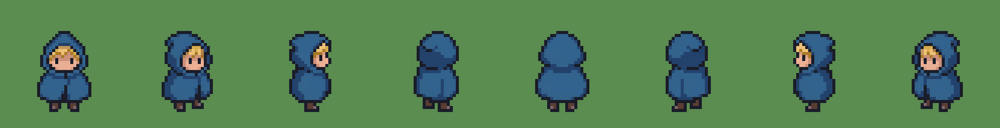
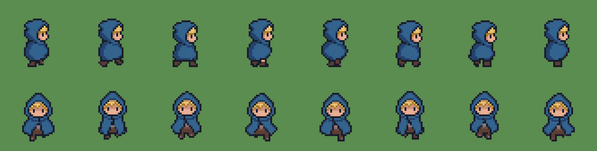
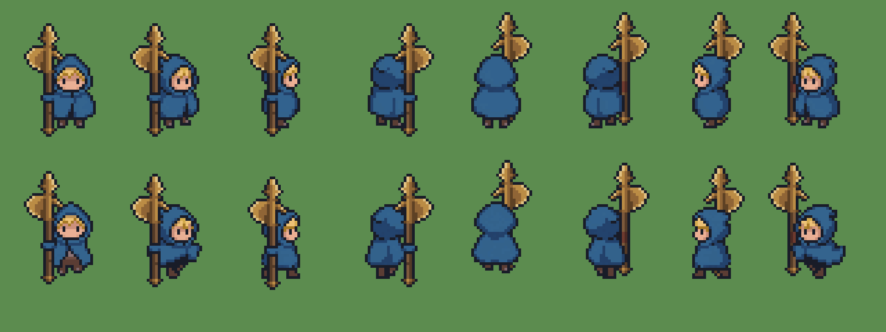

# Player animation

How the hero is drawn and animated.

[Systems overview](SystemsOverview.md) · [World and tilemaps](World.md)

The hero is an arm-less wanderer in a blue hooded cloak, drawn in eight directions with [PixelLab](https://www.pixellab.ai/) at 16 pixels per unit, the same density as the world tiles.

## Slots

`PlayerSpriteAnimator` is the only writer of the body sprite. It reads gameplay state and never drives it. Each state has a slot in `PlayerAnimationSet`.

| Slot | Plays while | Clock | Art |
| --- | --- | --- | --- |
| Rotations | Anything without its own clip | Single view | Yes |
| Walk / Run | Moving / sprinting | Distance travelled | Yes |
| Dash | Dodging | Dash progress | Yes |
| Throw | Releasing a throw | Aligned with the launch | Yes |
| Hurt | Staggered | Time | Yes |
| Drink | Drinking a flask | Drink progress; the swig lands with the heal | Yes |
| Rest | At a bonfire | Time, looping | Yes |
| Light attacks, finisher | Three-hit combo | Weapon action clock | Pending |
| Charge / Cleave | Charged spin | Time, then action clock | Pending |
| Catch, Death, Pickup | Their moment | Time | Pending |

Empty slots fall back instead of blocking: run uses walk, actions use locomotion, and everything ends at the standing views. A contact frame on each clip lines the drawn hit up with the first damaging physics step.

## Import

1. Put frames in `Assets/Art/Sprites/Player/<Slot>/<direction>/`, the layout PixelLab exports.
2. Run **Road of the Old King > Animation Import > Player**.

The importer sets 16 PPU point filtering, pins each direction's pivot to its lowest opaque row so feet stay on the ground line, and fills the slot. Playback rate, looping and contact frames live on the animation asset and survive re-imports.

## Weapon

The hero has no arms, so the bronze halberd is always a separate sprite, never part of the body frames.

- **Carry:** `PlayerWeaponCarry` holds one whole-pixel grip per facing, in front of or behind the body. A small cloak fold wraps the grip so a hidden hand appears to hold it.
- **Attacks:** procedural sweeps and thrusts, sampled from the same clock and geometry as the damage.
- **Recall:** the returning axe keeps its silhouette in translucent cyan with a short trail, then turns solid on the catch.
- **Hit pause:** a confirmed hit pauses only the weapon's clock, and body frames freeze with it because they sample that clock.
