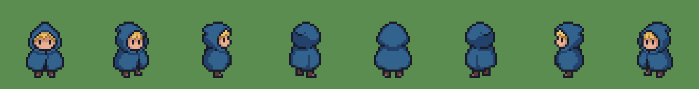
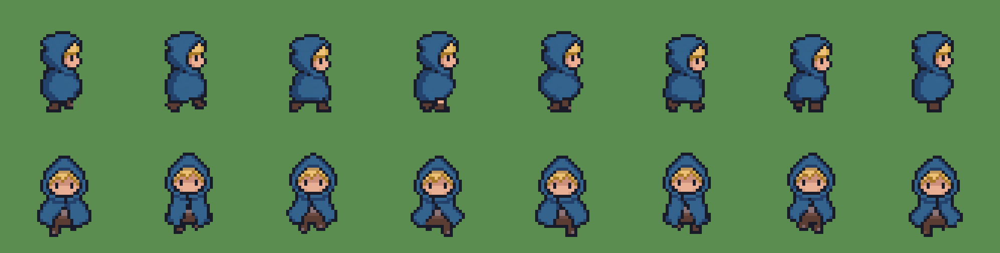
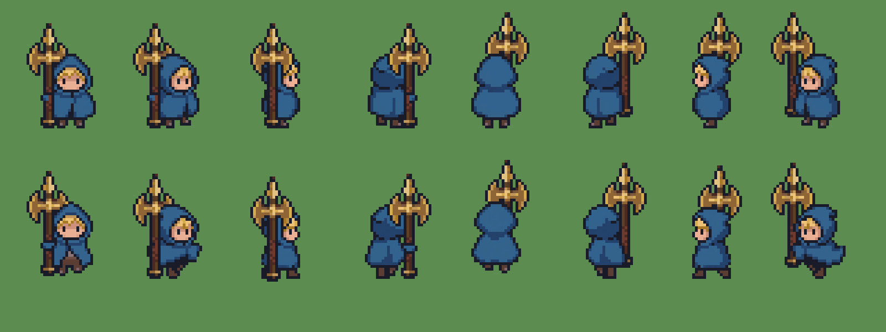

# Player animation

How the hero is drawn and animated.

[Systems overview](SystemsOverview.md) · [World and tilemaps](World.md)

The hero is an arm-less wanderer in a hooded cloak, drawn blue in eight directions with [PixelLab](https://www.pixellab.ai/) at 16 pixels per unit, the same density as the world tiles.

## Slots

`PlayerSpriteAnimator` is the only writer of the body sprite. It reads gameplay state and never drives it. Each state has a slot in `PlayerAnimationSet`.

| Slot | Plays while | Clock | Art |
| --- | --- | --- | --- |
| Rotations | Anything without its own clip | Single view | Yes |
| Walk / Run | Moving / sprinting | Distance travelled | Yes |
| Dash | Dodging | Dash progress | Yes |
| Throw | Releasing a throw | Aligned with the launch | Yes |
| Hurt | Staggered | Time | Yes |
| Drink | Drinking a flask | Drink progress; the swig lands with the heal | Yes |
| Rest | At a bonfire | Time, looping | Yes |
| Combat idle | Ready stance; see below | Single view | Yes |
| Light attacks, finisher | Three-hit combo | Weapon action clock | Pending |
| Charge / Cleave | Charged spin | Time, then action clock | Pending |
| Catch, Death, Pickup | Their moment | Time | Pending |

Empty slots fall back instead of blocking: run uses walk, actions use locomotion, and everything ends at the standing views. Without their own clips, light attacks hold the combat idle while standing still, and the charge and cleave turn through its views. A contact frame on each clip lines the drawn hit up with the first damaging physics step.

## Import

1. Keep the original PixelLab export in `ArtSource/Player/` at the repository root.
2. In the Unity project, copy the approved standing views to `Assets/Art/Sprites/Player/Rotations/<direction>.png` and numbered animation frames to `Assets/Art/Sprites/Player/<Slot>/<direction>/`.
3. Open **Road of the Old King > Animation Import**, choose **Player** in the **Character** list, then click **Import selected character**.

The importer sets sprites to 16 PPU with point filtering. For each direction, the lowest opaque row across the slot's frames sets their shared ground line. The throw release uses the standing rotation's ground line so the forward step stays visible. Playback rate, looping and contact frames survive re-imports.

## Weapon

The hero has no arms, so the bronze axe (a double-bitted head with a thrusting spike) is always a separate sprite, never part of the body frames.

- **Carry:** `PlayerWeaponCarry` holds one whole-pixel grip per facing, in front of or behind the body. A small cloak fold wraps the grip so a hidden hand appears to hold it. Facing south and south-east, the blade on his side of the haft draws behind his hood, as if slung over his shoulder; facing east and north-east the whole axe stays in his right hand, in front of him. The axe bobs with each step; seen from behind, where the hood doesn't rise and fall, it lifts a pixel as the feet pass.
- **Cloak colour:** chosen at New Game and kept in the save. The `EnemyFlash` shader turns the body's and the grip fold's blues into that colour by their brightness, so shading survives; an empty choice keeps the drawn blue.
- **Attacks:** procedural sweeps and thrusts, sampled from the same clock and geometry as the damage.
- **Recall:** the returning axe keeps its silhouette in translucent cyan with a short trail, then turns solid on the catch.
- **Hit pause.** A light hit pauses the weapon clock and any body frames driven by it. A hit on the player or an enemy's death can also briefly freeze the whole simulation.
