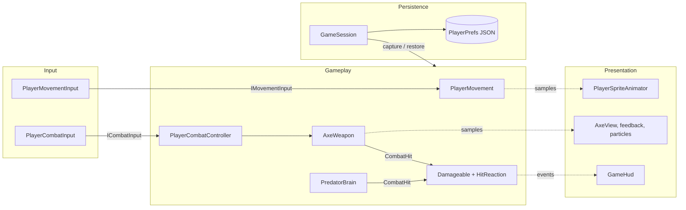
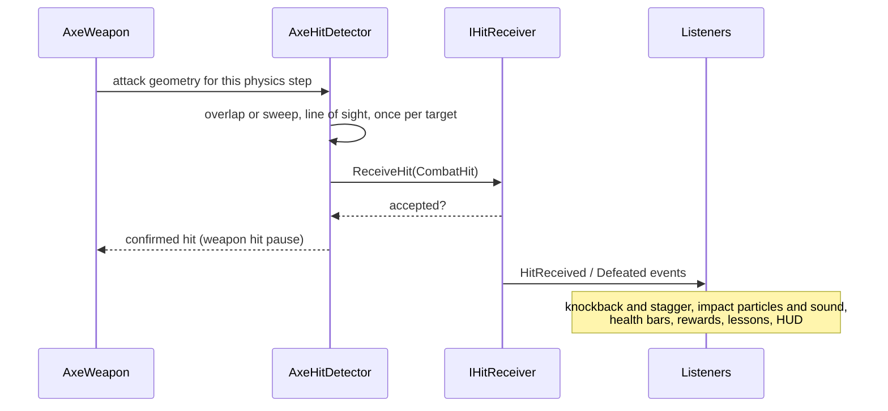
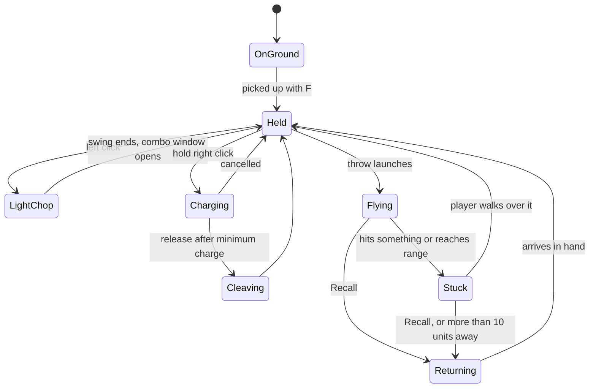
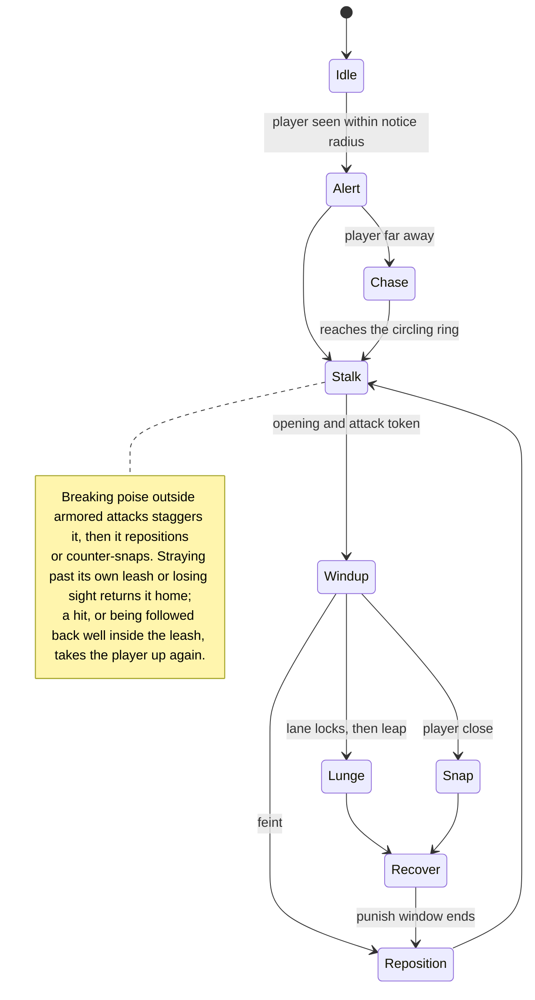
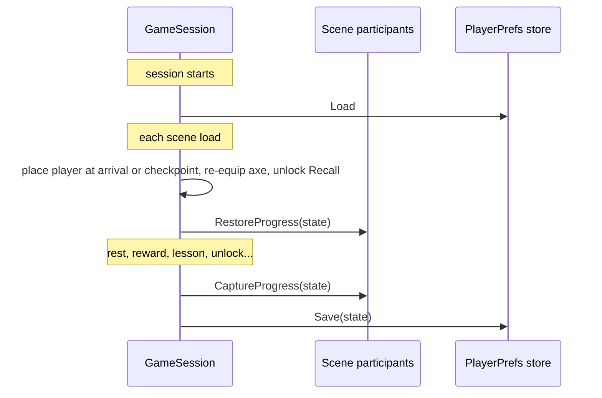
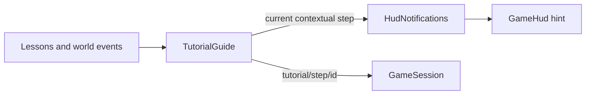

# Systems overview

[Player animation](PlayerAnimation.md) · [World and tilemaps](World.md) · [Changelog](../CHANGELOG.md)

This guide explains how Road of the Old King works at runtime: its major systems, which component owns what, and how they communicate. The enabled build scenes are `Title`, `Tutorial`, `GreenLowlands`, `LowlandsStorehouse` and `BarrowApproach`, in that order. The last scene is a small regional connector, not the finished Barrow Woods. Separate development scenes include `MovementPlayground`, `CombatEffectsPreview` and `LowlandsSluiceProof`. The original PrototypeLoop sandbox has been removed.

**Status:** the Tutorial is playable end to end: movement, axe pickup, throwing, melee, the first wolf, healing, the Recall awakening, a wolf pack, a Sun Shard and a bonfire. Its exit now leads to a Green Lowlands border road with two separated easy wolves before the farm bonfire, plus a return route, cross-scene travel, respawn and Continue. Green Lowlands now includes a regional blockout with an owned-crank Recall puzzle, coins, pots, chests, finite stock offers and a persistent workshop rope route. First-tier upgrades are available at the Lowlands bonfire; core regional encounters and final art remain unfinished. HUD and menus use the shared pixel font and frames.

[Architecture](#architecture) · [Player](#player) · [Combat](#combat) · [Enemies](#enemies) · [Progression and saving](#progression-and-saving) · [World and interaction](#world-and-interaction) · [Tutorial](#tutorial) · [Camera](#camera) · [Presentation and UI](#presentation-and-ui) · [Tools](#tools-and-verification) · [Limitations](#current-limitations) · [Key files](#key-files)

## Architecture

One rule runs through the codebase: **gameplay owns state; presentation only samples it.** Each mechanic has a single owner component, and everything else reaches it through small interfaces and C# events.

- **Single writers.** `PlayerMovement` is the only component that sets the player's velocity, `CameraFollow2D` the only one that moves the camera, and `PlayerSpriteAnimator` the only one that sets the body sprite. Dash, knockback, attack lunges and freelook feed these writers instead of competing for the component.
- **Input behind interfaces.** Movement, combat and camera look read `IMovementInput`, `ICombatInput` and `ICameraLookInput`. Bindings live in small adapter components.
- **Hits are data.** Attacks deliver a `CombatHit` value to any `IHitReceiver`. A weapon never knows what kind of object it struck.
- **Events for reactions.** `Damageable` raises `HitReceived` and `Defeated`. Knockback, particles, health bars, rewards, lessons and the HUD subscribe without the health component knowing about them.
- **Progress through participants.** Anything persistent implements `IProgressParticipant`, and anything that resets at a bonfire implements `IResetOnRest`.
- **Tuning in data.** Weapon stats, upgrades and animations are ScriptableObject assets. Scenes hold placement and per-instance overrides only.

| `Assets/Scripts/` | Responsibility |
| --- | --- |
| `Input` | Keyboard/mouse and controller adapters behind interfaces, the fixed controller layout and last-used-device tracking |
| `Player` | Motor, stamina, dash, health, combat controller, interaction, animation |
| `Weapons` | Axe state machine, hit detection, throw clock, settings, upgrades, weapon visuals |
| `Combat` | Shared hit data, health, reactions, protection and hit feedback primitives |
| `Enemies` | Decision policies, action ownership and abilities, enemy services and presentation |
| `Camera` | Follow, zoom, freelook |
| `Progression` | Checkpoint session, save format and store, upgrades, heart fragments |
| `World` | Pickups, bonfires, rewards, puzzle pieces |
| `Tutorial` | Lessons, Recall awakening, guide, exit |
| `UI` | HUD, notifications, menus, time control, F3 Debug Panel and F4 Developer Tools |
| `Prototype` | Shared practice target, combat preview driver and sluice proof controller |

Code lives under `RoadOfTheOldKing.*` namespaces. Rendering uses the Universal Render Pipeline with its 2D Renderer. World art, characters and interactive grass use lit materials under one white Global Light 2D per scene, so local lights (so far the Ardan's Edge fire) can warm what is around them. Collectibles, combat cues and effects stay unlit so they read the same in any light.

### Design patterns in use

| Pattern / architectural rule | Where | Purpose and limit |
| --- | --- | --- |
| Component composition | `Damageable`, `HitReaction`, `EnemyBody`, enemy policies and views | Brains compose common physics/lifecycle services and one action runner. Health, poise and feedback stay independent of enemy identity. |
| Strategy and exclusive action ownership | `IEnemyAction`, `EnemyActionRunner`, melee/charge, predator attack and evade actions | A policy selects an action; the runner accepts only one at a time and depends on interfaces. Actions own commitment, motion, contact and cancellation, using the shared phase clock. New actions do not require branches in the runner. |
| Finite state machines | `AxeWeapon`, `ThrowActionClock`, `PredatorBrain`, `PursuitBrain`, `RecallSluice` | Explicit commitment, active windows, recovery and transitions. These mostly use enums/switches, not separate GoF State objects. |
| Observer | `HitReceived`, `Defeated`, weapon events, `PlantCut` / `VegetationCoinPatch`, bonfire `Opened`/`Closed` | Presentation/rewards react to gameplay without gameplay knowing the subscribers. Subscribers detach when disabled. |
| Interface adapters | `IMovementInput`, `ICombatInput`, `IHitReceiver`, `ICoinPickupSource`, progress/rest/visit participants | Hardware, attack delivery and lifecycle consumers depend on contracts. They are not a global event bus. |
| Data-driven configuration | `AxeSettings`, `AxeUpgradeTier`, `AxeUpgrade`, vegetation and animation assets | Share immutable tuning; active clocks, cooldowns and upgrade accumulation belong to each runtime instance. |
| Services and persistence adapter | `GameSession`, `CheckpointService`, `RewardService`, `PlayerPrefsProgressStore` | Separate lifecycle, location and rewards from serialization. `GameSession.Instance` is the persistent singleton access point, not a general dependency container. |
| Command-style menu actions | `PauseMenuAction`, `PauseMenuCommands`, `SettingsCommands` | Menus invoke actions through a small command boundary; this does not imply undo/replay. |
| Owner-scoped leases and modal stack | `PlayerControlLocks`, `SimulationPause`, `MenuStack` | Overlapping menus cannot release each other's input/pause claims; only the top modal receives navigation. |
| Bounded pools | `VegetationDebris`, movement particles, `BonfireSmoke` | Reuse fixed particle storage; no per-particle GameObjects or allocation each frame. |
| Single-writer presentation | Player motor/animator, `AxeView`, `BonfireSpriteView`, `SluiceOutfallView` | Gameplay owns state and movement; views sample it. Outfall flow follows the existing gate stroke and pond reveal without owning progress, collision or another drainage clock. |

Keep this inventory aligned with actual code; planned patterns belong in working design notes.

## Player

`Player.prefab` is one self-contained prefab shared by every scene. The axe is a separate prefab placed in the world; the player equips it on pickup.

| Role | Components |
| --- | --- |
| Input | `PlayerMovementInput`, `PlayerCombatInput` |
| Motor | `PlayerMovement`, `PlayerDash`, `PlayerStamina`, `PlayerControlLocks` |
| Combat and health | `PlayerCombatController`, `PlayerHealth`, `Damageable`, `HitReaction`, `PlayerFlask` |
| Interaction | `PlayerBonfireInteraction` (pickups and bonfires) |
| Presentation | `PlayerSpriteAnimator`, `PlayerWeaponCarry`, `PlayerAimIndicator`, `PlayerMovementDust`, `PlayerHitFeedback` |
| UI | `GameHud`, pause menu (`PauseMenuInput`, `PauseMenuController`, `PauseMenuView`), `BonfireMenu`, `DefeatScreen` |

### Controls

Keyboard and mouse, or an Xbox-style controller (any standard gamepad). Both stay live; prompts, hints and aim follow whichever device was used last, and the mouse cursor hides while the controller is in use.

| Keyboard / mouse | Controller | Action |
| --- | --- | --- |
| WASD / arrow keys | Left stick | Move |
| Shift (hold) | L3 (click; ends when you stop, run out of stamina or click again) | Sprint |
| Space | B | Dash / dodge |
| Left click | RB | Light combo: sweep, reverse sweep, thrust |
| Right click (hold, release) | RT (hold, release) | Charged cleave |
| E | LT | Tap to throw, hold to aim and release to throw; while the axe is away, Recall |
| Mouse cursor | Right stick | Aim. On the controller, a released right stick keeps its aim briefly, then aim follows movement; standing still keeps it |
| Q | X | Drink a healing flask |
| F | A | Interact; light an unlit bonfire, then rest on a separate press |
| Tab | View | Inventory (pauses play) |
| Alt (hold) | LB (hold) + right stick | Look around |
| Mouse wheel | D-pad up/down (hold) | Zoom |
| Esc | Start | Pause |
| Arrows, Enter, Esc | D-pad or left stick, A, B | Menus: move, select, back |
| F3 / F4 | — | Debug Panel / Developer Tools (Editor, development and browser builds) |

`GamepadLayout` holds the controller binding paths, which each adapter adds beside its keyboard/mouse bindings. `ActiveInput` switches the active device on deliberate use (a button, a stick past half tilt, a key, a click, a scroll or a clear mouse movement), so stick drift or a bumped mouse does not flip prompts back and forth. Combat frames carry an aim source: the mouse pointer, a world direction from the sticks, or hold.

### Movement

`PlayerMovement` runs each physics step and decides, in priority order, what drives the `Rigidbody2D`:

1. **Stagger:** the knockback impulse plays out; input is ignored.
2. **Controls lost** (menu, awakening lock, focus loss, death): the body stops.
3. **Dodge:** a fixed 3.2 units over 0.36 s, in a locked direction.
4. **Weapon action:** attacks and throws scale walking speed, and the finisher adds its lunge.
5. **Free movement:** momentum eases the body toward the input velocity (walk 4.5 u/s, sprint 7.2 u/s) with separate acceleration, stopping and turning rates. Hard sprint impacts with static walls bounce slightly.

Ordinary locomotion writes velocity rather than the Transform and collides with walls. Momentum starts from the body's collision-resolved velocity, which stops slides at walls instead of letting them push through.

**Authored rope traversal** is an explicit motor mode before normal locomotion. `PlayerMovement.Rope.cs` owns the kinematic crossing between fixed anchors, with body sweeps that ignore only the assigned cliff. Landings must be clear, and attacks, dash, drinking, an away axe, combat or an existing control lock prevent starting. Its input lease blocks actions; pause freezes movement. Interruption restores landing footing and normal body behavior. Position saves during a climb record the departure, so Continue cannot resume inside the cliff.

### Stamina, dash and defence

- **Stamina** (`PlayerStamina`): a 100-point pool that works like Dark Souls. Any action can start while stamina is above zero, and its cost may push stamina into a deficit (down to −40), which lengthens the wait; an attack made that way deals 60% damage and swings 25% slower. Recovery runs at 40/s after 0.6 s and pauses during attacks, dodges and sprinting. Sprinting drains 18/s, stops at zero and needs 18 to start. The HUD bar turns dark red while in deficit.
- **Dodge** (`PlayerDash`): costs 18 stamina and has no cooldown; stamina is the only limit. Its first 0.24 s is invincible. Attacks and dodges can't interrupt each other, but Recall works mid-dodge.
- **Healing flasks** (`PlayerFlask`): three charges, refilled at a bonfire or on respawn. A drink is a commitment, as in Dark Souls: the charge is spent at once, you walk slowly and can't attack or dodge, the heal (40) lands late in the 0.9 s drink, and a stagger before then wastes it. Enemies treat drinking as an opening.
- **Defence** (`PlayerHealth`): the player's `IHitProtection` on the shared `Damageable`. It rejects hits during the dodge window and for 0.8 s after taking damage. On defeat, controls stop and the defeat screen restarts from the last checkpoint.

## Combat

### Hits

Every attack, player or enemy, is a `CombatHit` delivered to an `IHitReceiver`.

- `CombatHit` carries the source, attack kind (light, cleave, throw, Recall, enemy melee), damage, direction, knockback, stagger, a guard-break flag and the impact point.
- `AxeHitDetector` resolves the geometry. Enemy body capsules accept weapon hits independently of solid foot colliders. Capsules follow eight authored facing profiles; dead bodies and unrelated pickup/interaction triggers do not catch weapons.
  - **Melee:** overlaps are filtered by the swing's arc or thrust lane, and a line-of-sight check means walls protect targets.
  - **Flight:** a circle cast sweeps the whole distance travelled each step, so fast throws can't pass through objects between frames.
  - Each target is hit at most once per attack or flight leg.
- Receivers decide what a hit means:
  - `Damageable`: health, with an optional `IHitProtection` such as `ShieldProtection`;
  - `Breakable`: props, optionally full-cleave-only; accepted breaks also implement `IHitEventSource` for lessons. An optional stable progress ID keeps authored obstacles cleared on reload;
  - The practice stands, Recall stone and sluice targets.

  A new kind of hittable object never needs a change to the weapon.

- Only accepted hits raise events, so blocked, duplicate or already-dead hits produce no feedback.

### The axe

`AxeWeapon` is a single state machine that owns the weapon on the ground, in hand, mid-swing and in flight. The state decides which actions are legal, so melee is impossible while the axe is away and actions never overlap.

- **Throw timing:** the throw has its own clock (`ThrowActionClock`) layered over `Held`: prepare, optional aim hold, launch, recovery. A tap on E launches 120 ms after the press. Holding E aims while walking at 55% speed, and the release launches 40 ms later. Right click or a dash cancels the aim.
- **Throw cost:** stamina is spent on release (20). A Recall you trigger costs 10 and is refused with no stamina left, so the axe must be fetched on foot; on-foot retrieval and automatic Recall are free. Catching the axe leaves a 0.25 s opening with no attack, throw or dodge.
- **Recall:** locked until the Tutorial's awakening. Once unlocked, E pulls the axe back toward the player through terrain, damaging anything on its path. An axe that ends up more than 10 units away returns on its own.
- **Recall presentation:** the returning weapon retains its silhouette with translucent cyan shading and a short trail. `AxeView` uses a shared material only during Returning and restores solid art at catch/reset; damage, trajectory and normal sorting remain unchanged. See [weapon presentation](PlayerAnimation.md#weapon-and-hit-pause).

### Attacks

| Attack | Shape | Damage | Stamina |
| --- | --- | --- | --- |
| Light 1 / 2 | 160° sweep, then a reversed 120° sweep; reach 2.6 | 10 / 10 | 16 / 16 |
| Light 3 (finisher) | Straight thrust lane at 1.3x reach, with a 0.7-unit lunge | 25 | 24 |
| Charged cleave | 360° spin, radius 2.1; a full charge breaks guards | up to 30 | 35 |
| Throw | Flies 7 units at 12 u/s and sticks in what it hits | 15 | 20 |
| Recall | Returns at 16 u/s, hitting everything on its path except the target it is pulled out of | 10 | 10 |

These values live in `Assets/Settings/Weapons/AxeSettings.asset` and are a tuning baseline, not final balance.

- **Timing.** Each melee attack runs on the weapon's action clock: windup, active, recovery. Only the active window deals damage. The ground footprint (`AxeMeleeFeedback`), the weapon pose and future body animations read that same clock and geometry, so what the player sees is what hits.
- **Hit pause.** A confirmed light hit pauses only the weapon's clock: 0.045 s, or 1.8x on the finisher. Enemies and the world keep moving. A killing blow adds a brief global freeze (`HitStop`, 0.08 s).
- **Input feel.** Clicks are buffered for 0.25 s and chain within a 0.55 s combo window. Light attacks never root you: you keep at least 55% of walking speed. The charged cleave is the heavy attack: from 50% charge strength (about 0.57 seconds) through the spin it has hyper-armor, so hits still hurt but cannot interrupt it. Control loss, stagger, pause and death cancel pending attacks and throws, and a lost key release cancels a throw rather than firing it.
- **Upgrades.** `AxeWeapon.ApplyUpgrades` rebuilds effective stats from the saved selections and never edits the shared settings asset, so reloading can't stack a bonus twice.

### Reactions

`HitReaction` turns accepted hits into stagger and a physics knockback impulse. Knockback slides out under damping instead of stopping dead, and a killing blow pushes 1.6x harder. Enemies can have **poise**: damage accumulates and only staggers once it passes a threshold (the meter resets after a pause; thrown and Recall hits count half), and an AI can switch on **hyper-armor** during committed attacks. Hits that don't stagger keep only a nudge of knockback. The player and practice dummies have no poise, so every staggering hit staggers them. Feedback listens to the same events:

- `EnemyImpactFeedback`: impact sound and whole-pixel particles at the contact point;
- `WoodTargetFeedback`: wood chips and sound on practice targets;
- enemy health bars and hit flashes.

## Enemies

Enemy AIs implement `IEnemy` (aware, defeated, reset, a `PlayerDetected` event) and register themselves in `EnemyRegistry`, so shared systems such as the combat signal, the "!" cue, impact effects and the F3 panel work with any enemy without searching the scene.

Enemy code lives in the `RoadOfTheOldKing.Enemies` namespace and four folders:

| Folder | Responsibility |
| --- | --- |
| `Brains` | `PredatorBrain` selects circling, reactions and pack turns; `PursuitBrain` selects approach, attack and return. These are reusable behavior policies. |
| `Abilities` | `EnemyActionRunner` grants exclusive ownership to `IEnemyAction`. `MeleeAttackAction`, `PredatorAttackAction` and `EvadeAction` execute attacks/motion using `EnemyActionClock`; contact geometry stays in `EnemyMeleeDelivery`. |
| `Core` | `EnemyBody` shares sight queries, corpse motion, home/reset and visit restoration. Registry, encounter signal, pack tokens and the narrow `IEnemyFacing` contract live here. |
| `Presentation` | Sprite views, indicators, impact feedback and corpse sorting sample gameplay. `PredatorAnimationSet` extends the common animation data with extra predator clips and gait timing. |

Policies retain different senses and movement choices without duplicating the physics/lifecycle machinery. Definitions and per-component tuning are authoring data; each commitment copies its parameters into an instance-owned action. No action clock, target or cooldown is stored on a shared asset. Actual stagger, defeat, disable and rest cancel ownership; cancellation can preserve weapon knockback. Re-enabling a cancelled enemy starts idle, with no stale telegraph. Hit volumes read `IEnemyFacing`, without checking concrete enemy types.

`PredatorBrain`, currently used by wolves, chooses **stalk, commit, punish, reposition**. Its snap/lunge/evade execution now goes through the same runner as other enemies:

- **Stalk:** circles the player at a distance, reversing when blocked, which leaves openings for throws and Recall.
- **Lunge:** the main attack. The windup tracks the player, then the direction **locks** and the wolf leaps along a lane drawn on the ground (thin while tracking, thick once locked, red while active), so a sidestep after the lock avoids it. Some windups are feints that break off.
- **Snap:** a quick bite if the player stays close.
- **Recover:** a short pause after every attack, the player's punish window, before it trots back out to the ring.
- **Reading the player:** it sidesteps an axe thrown straight at it, runs at a player whose axe is away, hops back from swings, attacks at once when the player whiffs or throws the axe away, presses a tired player, and bites back when a hit fails to break its poise. Lunges are armored, and windups vary in length while the lock always comes a fixed beat before the leap.
- **Groups:** there is no shared attack turn. Each enemy attacks on its own rhythm: wolves after their circling timers, keeping apart while they circle; scavengers after a short cooldown spent holding about three units off. Group fights are shaped by placement and notice radii.

Scavengers watch a visible player for 0.9 seconds before pursuing. Their suspicion meter fills from white to yellow, then becomes a red alert. Breaking sight or leaving notice range drains full suspicion in 0.6 seconds; hitting them provokes immediately. Rest clears suspicion. This watching stage is configured on the shared scavenger prefab; wolves and boars retain their existing detection behavior.

Engaged scavengers duel with two authored attacks. A **step-in** (lane telegraph) lunges about 1.2 units with a short recovery. An **overhead** (arc telegraph) is used when the player is close, and as the single follow-up when a step-in misses a player still in reach; it is armoured once its direction locks and ends in a long recovery. The telegraph turns orange when either attack locks. Recovery is never cancelled and keeps its locked facing. During a short cooldown after a sequence, a scavenger holds about three units away, facing the player.

| Attack | Windup (lock) | Contact | Recovery | Damage |
| --- | --- | --- | --- | --- |
| Step-in | 0.55 s (0.25 s) | moving, 1.3 reach, 70° | 0.55 s | 15 |
| Overhead | 0.80 s (0.45 s), armoured after lock | 2.0 reach, 80° | 1.10 s | 24 |

The Mossback Boar charges at range and sweeps its tusks when the player is within about 1.2 units. The charge is armoured only while running, never in its windup. A missed charge always ends in its recovery, with no follow-up. Running head-on into a visible wall or rock stuns it for the longer recovery; grazing contact, other enemies, breakables and invisible colliders do not.

| Attack | Windup (lock) | Contact | Recovery | Damage |
| --- | --- | --- | --- | --- |
| Charge | 0.85 s (0.35 s), armoured while charging | 10 u/s for 0.8 s, 1.05 reach | 1.10 s, 2.20 s after a head-on wall | 24 |
| Tusk sweep | 0.60 s (0.35 s) | 1.6 reach, 150° | 0.80 s | 14 |

The Thorn Rat uses the same brain: a 0.35 s crouch, a short dart for 6 damage, then it holds about 2.6 units off for a 0.9–1.7 s cooldown, randomised per rat so a swarm doesn't strike together. It has 10 health and drops no coins. `EnemyWeaponView` draws an armless enemy's separate weapon (the scavenger's bronze spear) from the brain's facing and attack phase, so the weapon follows the telegraphed lane.

`PredatorSpriteView` samples the AI: circling, repositioning and chasing use stalk, walk and run animations driven by distance travelled; the bite's frames follow the windup clock so the jaws open on the leap; death plays once and holds as the corpse. The wolf also carries `EnemyHealthIndicator`, `EnemyAwarenessIndicator` and `EnemyImpactFeedback`. `EnemyCorpseSorting` on both enemy prefabs moves defeated sprites below the player and restores each original sorting layer/order when rest revives them. `EncounterState` is the shared "in combat" signal: true while any registered enemy is aware of the player or the player was just hit, plus 3 s of grace.

`PursuitBrain` chooses approach/attack/return for the sentinel, Road Scavenger and Mossback Boar. `MeleeAttackAction` implements stationary melee or a charge, including early tracking, locked direction, optional armour from the lock or for the active window only, active contact and recovery, and a longer recovery when a charge meets a visible wall head-on. Per-component melee tuning remains valid when no definition is assigned. A swept collider stops charges at solids; one contact ends the Boar charge. `PredatorAttackAction` preserves the wolf's single-attempt snap, moving bite, late lane lock and committed-lunge armor; the policy selects feints and follow-ups. `EvadeAction` supplies retreat and lateral sidestep. Pack ownership remains reserved across the attack/recovery sequence. Wolves hop back when a strike begins (a light chop or a released cleave), not while a cleave is still charging. Both brains take home, leash and sight from the shared `EnemyBody` and leash on the enemy's own distance from home: an aware enemy keeps chasing past its notice radius until it strays past the leash or loses sight, then walks home and re-engages if hit or followed back inside 60% of the leash.

## Progression and saving

`GameSession` is one game-level session for every scene. Each playable scene contains the `GameSession` prefab so it can be played directly; the first instance survives scene loads through `DontDestroyOnLoad`, and later copies remove themselves, so the save key and upgrade tiers always come from the prefab. It owns the player's permanent progress and writes it through `IProgressStore` as one versioned JSON record in PlayerPrefs, which also works in the browser build. Two services hang off it: `CheckpointService` (lighting, rest, travel, scene exits, respawn and placing the player on load) and `RewardService` (shards, fragments, coins, tools, inscription knowledge and purchases).

- **Versions.** `ProgressMigrations` reads any known save version and upgrades it step by step. Version 2 replaced the per-scene Tutorial save. Version 3 adds a wallet, owned tools and pending/exhausted coin sources; v1/v2 records retain earlier progress and start with an empty economy. Legacy-key migration keeps the original as a backup until New Game.
- **Scene changes.** `SceneTransitions`, on the session, fades out with the world frozen and input locked, loads the scene and fades back in. The session places the arriving player at a named `SceneSpawnPoint` (or a fire, for travel), otherwise at the checkpoint fire if it is in that scene. A spawn's optional world-space `arrivalFacing` sets the idle pose without forced movement; zero retains the player's initial facing.
- **Exits.** `SceneExit` is a trigger with a target scene and spawn id. It saves, carries current health and flask charges across, and can record a milestone on first use. Doorways can specify a world-space `inwardDirection`: only the player's solid foot collider, active inward movement intent and inward body velocity commit the transition. Sideways contact, retreat, child triggers and locked input do not; a player already overlapping can begin walking inward to enter. Zero keeps ordinary overlap exits. These doorways use the same fades and ordinary visit-state preservation, without healing or changing the checkpoint. Tutorial and Green Lowlands have reciprocal exits and named arrival points; the Tutorial exit records `tutorial/complete`. An unconfigured exit only shows its notice.
- **Resume point.** `ResumePoint` (scene, position, health, flasks) is a small record beside the save. It is written when the player pauses, leaves to the title, quits or the window loses focus, and by a throttled autosave (every 5 s, only when alive, out of combat and moved). Death, resting, travel, Return to bonfire, scene exits and New Game clear it. If the store fails, the in-memory resume still serves Continue in this session, and the pending write or clear is retried on the autosave tick (a small budget per change) and again on focus loss, quit and Main Menu; the newest change supersedes older pending work. A clear always deletes and flushes, because a failed flush can leave the cached key gone while the stored resume remains. The exact position is validated after progress participants restore saved world state (drained water, opened passages, cleared obstacles), since scene objects load in their authored state. A body-sized solid query then rejects obstructed/nonfinite positions; the already placed arrival/checkpoint stays in effect, with saved health and flasks still carried. Clear resumes remain exact.
- **Title.** The game starts in the `Title` scene. Continue resumes at the resume point if there is one, otherwise at the checkpoint's fire (or the new-game scene's start without a checkpoint); New Game clears the save, confirming first when one exists; the pause menu's Main Menu saves and returns there.
- **The axe.** Taking the axe from the Tutorial stump is a one-time pickup. Once the save owns it, `PlayerCombatController` spawns the player's own copy from its `ownedAxePrefab` on every scene load, and an unowned world axe with `AxePickup` hides itself.

**What's saved (`ProgressState`):**

- axe ownership and the Recall unlock;
- the last checkpoint and its scene, plus discovered fires with their scenes (so travel can list fires in other scenes);
- the Sun Shard balance and chosen upgrades;
- Bronze Coins, owned tool IDs and one-time coin-source results, including empty and uncollected results;
- a list of completed string IDs, including secured rope routes.

The ID list holds most progress: lessons, collected rewards, guide steps and solved puzzles, for example `tutorial/lesson/melee`, `shard/collected/<rewardId>`, `tutorial/step/<id>` and `tutorial/complete`. IDs are permanent; renaming one that has shipped orphans saved progress.

**Participants.** The session doesn't know how objects represent their state. On capture, each `IProgressParticipant` writes itself into `ProgressState`; after a scene loads, each one restores itself from it.

**Ordinary scene visits.** `SceneVisitState` separately keeps temporary `ISceneVisitParticipant` snapshots in memory when leaving through a scene exit. Returning restores enemy health, corpse positions and exact vegetation cut masks. Living enemies resume idle at home. Restoration emits no combat hits/defeats or cutting debris, so it cannot replay rewards. Rest, death/Return to bonfire and bonfire travel clear all visited scenes; Continue/New Game start fresh encounters as before. These snapshots are not durable saves. Keys combine the scene path with authored hierarchy names, same-name sibling ordinals and component type; future dynamically spawned or reparented participants need stable spawn identities before adopting this mechanism. Capture/restore runs only at scene boundaries, with no per-frame scans or per-plant objects.

| Event | Checkpoint | Heals and resets enemies | Saves | Reloads scene |
| --- | --- | --- | --- | --- |
| Rest at a bonfire | Set to that fire | Yes | Yes | No |
| Permanent gain (axe, Recall, shard, fragment, lesson, puzzle) | Unchanged | No | Yes | No |
| Quit, Main Menu, pause, or the window losing focus | Unchanged | No | Resume point only | No (Continue later loads the exact spot) |
| Leave through a scene exit | Unchanged | No (health and flasks carry over) | Yes | Loads the target scene at its spawn point |
| Death or Return to bonfire | Unchanged | Through the reload | Yes | Yes: the checkpoint's scene at its fire, or this scene's arrival point without a checkpoint |
| New Game (title screen, confirmed over a save) | Cleared | Through the reload | Save deleted | Yes, the new-game scene |

**Economy and tools.** `RewardService` records each authored source result before showing its drop. Collection saves the wallet and source exhaustion together; pending coins reappear at their authored source after loading, and death keeps the wallet. `ShopOffer` validates reach, physical access, price, ownership and stock before saving the debit, reward and finite-stock flag together. Tool ownership is shared across scenes. The existing session-only save-failure status still applies. Tab shows coins and tools.

**Charged cleave presentation.** A charge can be held indefinitely (stamina recovery stays delayed while it is held). Reaching full strength flashes the body (`PlayerHitFeedback`) and plays a short ring (`AxeView`). On release the hero steps `cleaveStepDistance` (0.35 units) along the aim over the first 30% of the spin, through the same collision-aware displacement as the finisher lunge. Until dedicated art exists, `PlayerSpriteAnimator` coils one octant against the spin while charging and turns the standing views with the axe's orbit during the cleave.

**Charged cleave buildup.** Over the existing 0.8-second charge, strength follows `(exp(2t)-1)/(exp(2)-1)` for normalized elapsed time `t`. The HUD, weapon pose, partial damage/impulse and late-charge armor threshold read this same value. Movement falls from 80% to 8% of walking speed as strength builds; sprint cannot bypass it. Full charge still deals 30 damage and has 0.45-second recovery. Starting a charge needs stamina above zero but costs nothing; the 35 stamina is paid when the cleave releases, so taps released before 0.2 seconds cancel for free and cannot drain stamina, and a release that cannot pay cancels. Only a full-duration charged cleave can break a `requiresFullCleave` object; damage amount or a guard-breaking hit of another kind cannot substitute.

**Rewards and upgrades**

- **World rewards** are three separate pieces (18 Oct):
  - **The condition**, `EncounterUnlock`: a list of guards. When the last one falls it records its milestone (saved) and raises `Unlocked` with where that guard fell. A reward references it, or just requires its milestone.
  - **The pickup**, `RewardPickup`: the base of `SunShardReward`, `HeartFragmentPickup` and `ToolPickup`. It owns the visual, prompt and reach checks, an optional required milestone, an optional `unlock` (appearing where the last guard fell, or granted immediately) and the grant request.
  - **The record**: `RewardService.TryGrant(kind, id, …)` and `RewardKeys`, the one owner of the save keys `shard/collected/`, `shard/available/`, `coins/collected/`, `tool/collected/` and `shop/purchased/` (heart fragments stay in `HeartFragmentProgression`).

  So a fight-gated fragment or chest is scene setup, not new code. Each reward is one-time even though enemies come back. The Tutorial shard's wolf pack is an `EncounterUnlock` whose milestone is the `shard/available/<id>` key that older saves already hold.
- **Upgrades** (`WeaponUpgradeProgression`): tiers of three mutually exclusive choices, defined as `AxeUpgradeTier` and `AxeUpgrade` assets. Buying one for 3 shards at a bonfire that offers upgrades removes the other two for the run. Tier one:
  - **Quick Hands:** the three-hit light combo, including its finisher and recovery, runs 20% faster with unchanged damage and stamina costs.
  - **Deep Notch:** third combo hit damage increases from 25 to 30, with unchanged reach, timing and stamina.
  - **Wide Cleave:** cleave radius 2.1 → 2.6.
- **Heart fragments:** every three collected add 20 maximum HP. The count is derived from collected IDs rather than stored separately, so it can't drift. The mechanic is complete but not yet placed in the Tutorial.

Tiers can keep former offers in `retiredChoices`. Saved selections resolve against active and retired entries, while new purchases accept only active entries. Replacing an offer therefore need not remove an existing character's upgrade. Tier one retains Sweeping Edge for existing owners with its original effect. New characters choose Quick Hands, Deep Notch or Wide Cleave for three shards at the Lowlands bonfire. Tutorial fires offer previews only.

## World and interaction

- **Tilemaps.** Visual layers are separate from an invisible Collision map, and canopies and roofs draw on an Above Player layer. Elevation is visual only; everything shares one physics plane. See [World and tilemaps](World.md).
- **Scene layout.** Every scene follows one hierarchy. The region root (a Grid) holds `Collision`, ground and path maps, `Terrain`, `Scenery`, `Gameplay`, `Encounters` and editor-only `Authoring` guides. Beside it at the scene root are `Player`, `Game Session`, `Cameras` and `Lighting`; the session must stay a root object for `DontDestroyOnLoad`. Gameplay objects, usually prefab instances, are grouped under `Gameplay` by purpose (lessons, bonfire and transitions, rewards, area names), and enemies sit under `Encounters`. The Recall seal combines scene-authored tilemaps with a gameplay component and collision.
- **Interaction (F).** `PlayerBonfireInteraction` is the single interaction selector.
  - It picks one nearby `WorldPickup` (axe, shard, fragment, tool, chest, crank, inscription or shop offer) first, otherwise a nearby bonfire. One press commits one thing.
  - The HUD prompt reads the same selection, so it always matches what F will do.
  - Coins collect through a proximity trigger with a physical-access check; the owned axe is also retrieved by walking over it. Other rewards use F.
- **Place names.** `AreaName` zones are plain world rectangles (no colliders); a few times a second the smallest zone containing the player names its place, so landmarks inside a region announce themselves. A new name posts `HudNotifications.ShowArea`, and `GameHud` shows it once no milestone banner, menu or scene fade covers it: regions in RotOK Title32 with the kit divider, landmarks (`landmark` zones) a tier smaller in RotOK Heading16, both outlined in ink over a soft stepped ink band for contrast on bright ground. The last name survives scene loads (respawning in the same place stays quiet) and the same name waits 60 s before repeating.
- **Reward presentation.** `PickupPresentation` animates a reward's art without moving its collider or owner. When an `EncounterUnlock` reveals a reward in play, `Revealed` drops it in under a brief light column with a bronze chime; loading shows it quietly. Uncollected shards and hearts keep a slow rise of pixel motes, and coin pickups holding more than one coin show a pile sprite (`ShowCoinAmount`). Motes and lights follow the reduced-flash setting and dark-interior visibility.
- **Bonfires.** `Bonfire` holds a stable ID, a display name and a spawn point. As in Dark Souls, the first interaction (prompt "Light Bonfire") lights an unlit fire and saves its discovery for travel, without healing, refilling, resetting enemies/grass, moving the checkpoint or opening a menu; a brief "BONFIRE LIT" banner (`HudNotifications.ShowBanner`) crosses the upper third of the screen. A separate interaction (prompt "Rest") sits down and rests: it heals, refills stamina/flasks, returns the axe, resets enemies/grass, sets the respawn point and saves, then opens the bonfire menu with Upgrades, travel destinations and Leave. Sitting is the rest, so the menu has no separate Rest entry. Discovered fires offer travel between them, including fires in other scenes; travel saves and respawns at the destination. The Lowlands Bonfire (`green-lowlands/arrival-fire`) supports rest/travel and first-tier upgrade purchases for three Sun Shards. All bonfires inherit the same flame from the shared prefab; regional bases may vary. `BonfireSpriteView` samples discovery state and animates four native flame frames at 6 fps; the flame stays hidden before discovery and changes no gameplay state. `BonfireSmoke` emits 1.5 crisp pixel puffs per second from lit fires with a 12-particle cap, shares flame depth, pauses with game time and clears on disable. Its dedicated unlit material is referenced by the shared fire prefab. Each puff uses two flat colors, a fixed 16-PPU grid and discrete shrinking silhouettes, with opaque pixels instead of blur or transparency fades.
- **Regional enemies.** Nine Road Scavengers and one Mossback Boar use `PursuitBrain` with native eight-direction standing, idle, walking and running through `MeleeSpriteView` (run above 4.8 units/s, e.g. the boar charge, or at any speed for sets without a walk). Their shared runner supports stationary melee and a charge that tracks early, locks direction, stops on contact/obstacles and exposes a recovery window. Attack/death art is pending; arc/lane telegraphs and a fade are explicit provisional fallbacks. `EnemyMeleeDelivery` shares contact geometry/occlusion with the wolf snap. `EnemyCoinDrop` rolls once per life and reuses `CoinPickup` through `ICoinPickupSource`. Drops stay at the fall position, survive ordinary scene visits, and reset with enemies at rest/death/Continue; collected wallet coins persist. Only configured enemies are eligible. Native view.
- **Tutorial breakables.** Two shrubs after the axe pickup teach swing, and a cracked stone near dummy practice requires a fully charged cleave. They use shared production prefabs, `HitCountLesson` and the existing guide. Cleared obstacles and completed lessons persist independently; the route stays passable around them.
- **Pots and chests.** `Breakable` raises one accepted-break event. `CoinSource` owns a saved result and pending pickup, with six brief ceramic flecks for feedback; pots stay broken after rest/reload. `RewardChest` supports fixed shard, fragment, coin or tool contents (`RewardKind`), grants through `TryGrant` and restores opening from `RewardKeys`. Its optional `RewardChestSpriteView` plays a .22-second three-pose opening after the immediate reward commit; restore displays the final pose without replay. `WorldPropDepth` sorts native chest/pot art against the player's fixed ground position. `EncounterUnlock` saves a permanent guard-group milestone; empty or missing assignments fail closed.
- **Inscriptions.** `ForgeInscription` is a persistent, rereadable interaction with distance, solid-access and optional encounter checks. `RewardService` records the first reading; `ForgeInscriptionProgression` counts valid distinct catalog IDs in existing milestones. `InscriptionReader` uses shared menu routing and pause/control leases, including a closing-frame input shield. Knowledge appears only in the reader and Tab inventory, without a hidden-site checklist. A second authored inscription is available in the dark interior and requires actual light to read. The final forge upgrade remains unimplemented; shared pickups require enough light to interact inside a dark interior.
- **Dark interiors.** `LowlandsStorehouse` is a first playable room loop with reciprocal `SceneExit`/`SceneSpawnPoint` entrances. The interior's global light is 0; light comes from URP 2D lights. Owning the Protected Lantern turns on a warm, gently flickering point light on the player whose shadows come from a cast-only `ShadowCaster2D` on each drawn wall-face strip (the bricks catch the light; everything behind them falls dark), and a freeform daylight pool marks the entrance for retreat without the lantern. `DarkInterior` draws one cover quad after the world whose shader (`InteriorDarkness`) reads the 2D light at each pixel and turns black where none reaches, so unlit world UI and effects stay hidden; screen HUD stays readable. `WorldPickup.CanCollect` uses a stable analytical reading gate (`VisibilityAt`) cast from the lantern height against the same wall-face strips, with two native pixels of clearance at soft shadow edges. It ignores cosmetic flicker and approximates the light radius; it is not a pixel-exact match for URP falloff, soft shadows or the cover shader. The first interior dressing includes reused crates/timber, ordinary breakable pottery and a persistent inscription. Final art, lantern acquisition and further destination connections remain unfinished.
- **Regional sluice.** `RecallSluice` binds actual lodging and ordered return hits to one axe flight, moves the lodged axe on a carriage and saves service-diverted/pond-low states. Regional sockets require the maintenance crank; the separate proof retains installed cranks.
- **Roofed buildings.** `BuildingCutaway` reveals assigned Sprite/Tilemap roof and facade renderers when the player's feet enter authored local rectangles. A .2-second fade and .25-unit exit margin prevent doorway flicker; enable and first-frame arrival restore the appropriate coverage immediately. Disabling restores original colors and enabled states. Rooms, interactions, collisions and the shared camera remain active. The Lowlands sluice uses a south-facing doorway reached around the building's east side, two slate roofs, quiet service floors and cool machine beds with distinct mechanical fittings. Three reveal areas cover both bays and the service passage while keeping the exterior porch outside; leaving the doorway restores the roofs. The farm buildings and storehouse arch also have their depth revisions; human art review remains pending.
- **Mechanical feedback.** Regional `SluiceMechanismView` slides the released bolt, lifts and settles the brake, and gives the counterweight a small blocked tug or an accelerating release drop. Its suspension follows the weight. The new exterior bronze gate lifts 1.5 units on the same stroke; blocked attempts leave it shut. `SluiceOutfallView` observes that opening and the existing pond reveal to cycle four native flow frames at 8 fps, diminish the surge, expose wet masonry and retain a small rivulet. The pond intake enters a covered culvert; a separate western tailrace carries the discharge away. These views do not move receiver colliders, grant progress or change water collision. The former small shutter assembly is visually retired. `SluiceFeedback` adds local fitting recoil/sparks, crank rotation and attenuated latch, blocked-knock, ratchet, weight, gate and draining-water sounds. Reachable unsolved sockets respond even when locked or missing the crank; they still require the same stage and tool to succeed. Effects leave receiver colliders fixed, follow water/gate motion, respect pause and reduced-flash settings, and settle silently on rest/load.
- **Water transitions.** Regional `SluiceWaterReveal` components retain the existing water art and collision while the water recedes: a crisp shader edge clears the service channel over 1.2 seconds, and the pond drains over eight seconds following a baked bed-depth map, exposing shallow edges before deeper channels. The final outcome saves before presentation begins. Completion releases the flooded collision group; rest/load or interruption settles immediately into the saved configuration. The permanent river is separate. The proof scene retains instant swaps.
- **Recall mechanisms.** `RecallAwakeningStone` and `RecallSealGate` own the Tutorial awakening and gate. `RecallSluice` and `SluiceTarget` own the Lowlands mechanism; the old sandbox throw/Recall door puzzle is retired.
- **Vegetation.** `InteractiveVegetation` renders a baked `VegetationLayout` in small spatial mesh groups sharing one atlas. Grass pairs two intact leaf sprites with independent phases; flowers and reeds use one sprite each. Continuous GPU rotation around bottom pivots combines wind with a bounded player trail, preserving UVs and source pixels while deliberately allowing smooth rotated pixel art. Nearby roots sort against the player's stable feet line through ground/foreground draws sharing the same mesh; distant foreground draws stay disabled. `WeaponSweep` reports actual axe damage intervals and traveled flight segments independently of hit receivers; nearby plants are cut without hit pause or plant colliders. Authored `VegetationCoinPatch` observers reveal one persistent `CoinSource` outcome on the first cut within a clump, then detach; there is no per-blade reward or frame polling. Walking and restoring cut masks emit no reward. Empty/collected outcomes remain exhausted after regrowth; pending coins restore at the authored clump center. `VegetationDebris` throws atlas leaf fragments and soft green motes with smooth arcs, spin and fading, using a fixed 192-particle pool and one shared mesh with front/back draws. `IResetOnRest` restores the field and clears debris; cut state is not saved. Tutorial is the first placement, with density excluding paths and interaction clearings.

`RopeAnchor` is a contextual F interaction at either end of a `RopeRoute`. The first valid use requires a purchased rope kit and saves a unique secured ID; subsequent trips cost nothing. `RopeRoute_Placeholder.prefab` now provides native stone/bronze anchors and a hemp span at 16 PPU; each scene supplies a unique route ID and traversed cliff. The Green Lowlands workshop has a two-way route, a safe landing outside initial guard awareness, and an expanded yard. Both guards must be defeated to unlock its existing rewards; the unlock persists when enemies revive.

`Trader` provides one contextual F interaction, which opens a short conversation (`DialogueBox`): a greeting on the first talk of a visit, a shorter line after that or once his packs are empty, then Trade, Ask about the road (a little lore) and Farewell. Trade hands the conversation's control lease straight to the shop. He calls out when the player comes near (`HudNotifications.Say`, shown as a chip over his head; one bark per 20 s), and says goodbye after Farewell or the shop. `TraderWalker` lets him potter about a 3.5x1.5-unit patch around his spot, stopping and turning to face a nearby player and standing still while engaged; `TraderSpriteView` plays the user's PixelLab breathing idle and walk in eight directions. He has no collider, and his baked shadow is a child that moves with him. Merchant-owned `ShopOffer` objects leave the world-pickup registry and validate reach/solid access at their merchant; the original `RewardService.TryPurchase` still commits wallet, reward and stock together. `CollectionMenu` on the shared Player handles stock, purchase confirmation and Tab inventory through the shared menu stack and pause/control leases. Opening or browsing spends nothing; confirmation defaults to Back, unavailable purchases are disabled, and bought stock leaves the list; an emptied trader says there is nothing left to sell. Leaving reach, disabling the menu, death or a scene transition closes it. The offers' old placeholder stand stays hidden. Capture-phase UI navigation suppression prevents a second native button activation after MenuStack handles Enter.

## Tutorial

The route teaches one verb per space, and each lesson completes from a real outcome rather than a key press.

| Beat | Teaches | Completed by |
| --- | --- | --- |
| Village well | Movement | Distance walked and six seconds of guidance |
| Axe stump | Pickup | Owning the axe |
| Throw stands | Throwing, retrieving on foot | `ThrowRetrieveLesson`: one thrown hit on a stand, then the axe back in hand |
| Practice dummy | Light combo, dodge | `HitCountLesson`: three melee hits; any dash |
| Forest road and bridge | Sprint, travel | Distance sprinted, reaching the road |
| Ruins past the bridge | First fight | A lone wolf; `DefeatMilestone` records `tutorial/enemy/first-wolf` |
| Courtyard recovery | Healing | An actual flask heal after the wolf; full health or no charges bypasses the reminder |
| Ancient stone | Recall unlock | `RecallAwakeningStone`: a thrown hit after the wolf and safe recovery |
| Meadow | Wolf pack, first Sun Shard | Two wolves (they take turns attacking); the shard unlocks when both are down, where the last fell; collecting it |
| Roadside bonfire | Rest and checkpoint | First rest |
| Exit trail | (end of route) | `SceneExit` records `tutorial/complete` |

**Recall awakening.** A thrown hit on the stone locks controls and plays a 1.4 s awakening. The stone then unlocks Recall and returns the axe automatically, restores controls and saves once. Death mid-sequence aborts cleanly, and a save with Recall unlocked loads the stone already awakened.

**Guide.** `TutorialGuide` holds an ordered list of steps authored in the Inspector. Each step has a stable ID, hint text with key tokens such as `{throw}`, and a condition: Moved, Sprinted, Dodged, HasAxe, RecallUnlocked, Rested, Milestone, ReachArea, DrankFlask or Looked. Teaching can anchor to a world object or the hero; nearby interactions take priority, with a screen fallback for off-screen destinations. Combat, drinking and the awakening hide teaching. The stone waits for the first wolf and safe recovery; full health or empty flasks bypass the healing reminder. The target Recall drill is removed. `RecallSealGate` blocks the courtyard's northern exit until the stone awakens; it opens immediately for saved Recall progress. WASD guidance stays for at least six visible seconds, retrieval guidance waits for the axe to land, and the Alt hint tracks the camera's actual freelook state.

- **Progress-aware:** conditions are tracked from scene start, so early actions count. The hint is the first incomplete step after the furthest route landmark reached (the bridge, the awakened stone, a rest), so skipped lessons stop following the player but still complete if done later; the ready stone takes priority nearby. The guide itself places no barriers, but the stone waits for the recovery milestone and the seal physically gates the northern route.
- **Out of the way:** hints hide during combat, menus, pause and death.
- **Extensible:** lessons are independent components that only record milestones, so a new lesson needs no guide code; a Milestone step can watch any progress ID.

## Camera

Every scene uses `FollowCamera.prefab`:

- **Follow** (`CameraFollow2D`): smooth follow, and the only writer of camera position.
- **Zoom** (`CameraZoom2D`): mouse-wheel or held D-pad zoom between orthographic sizes 3 and 8 (the Tutorial allows 10). A session starts at 6.5 (`defaultSize`); after that the player's zoom is shared by every scene's camera, so it carries across areas, Continue and travel until the game closes. The D-pad zooms only while no menu is open, since it navigates menus.
- **Freelook** (`CameraFreelook2D`, `CameraLookInput`): hold Alt to look toward the cursor, or hold LB and steer with the right stick, up to three tiles. The view returns smoothly on release and resets on pause, focus loss and respawn.
- **Vistas** (`CameraVista`): world rectangles, like place names. While the player stands in one, the camera eases out past the player's zoom limit and frames the player at a set screen point, so a view ahead (a ruin below a ledge, a valley at the end of a road) fills the screen; leaving hands the player's own zoom back. Vistas use the same framing and zoom override as the bonfire close-up; freelook and follow lag are limited around the framed centre.

## Presentation and UI

Presentation components read gameplay state and never change it, so art can be replaced without touching the rules.

| Component | Shows |
| --- | --- |
| `PlayerSpriteAnimator` | The hero in eight directions. Walk and run advance with distance travelled, actions follow their clocks, and missing art falls back gracefully ([details](PlayerAnimation.md)) |
| `PlayerWeaponCarry`, `AxeView` | The halberd at the hero's side, procedural swings, flight and trails |
| `AxeMeleeFeedback` | The swing's ground footprint: outline during windup, fill while active |
| `PlayerAimIndicator` | Cursor aim chevron |
| `PlayerMovementDust` | Speed-scaled dust trail and skid clouds |
| `PredatorSpriteView`, enemy indicators | Enemy poses, the "!" awareness cue, health bars |

**HUD.** `GameHud` (UI Toolkit, `UI/GameHud.uxml` and `.uss`) is contextual: quiet exploration shows almost nothing.

- **Vitals:** pixel-art health bar and one flask icon per charge in the corner, shown on damage, healing or combat and hidden 3 s after health is full and no threat remains. Bars grow with their maximum. The *Vitals* option on the Settings page keeps them always visible and adds a stamina bar (`HudSettings`).
- **Stamina arc:** in combat, or whenever stamina is below full (so sprint reserves read outside fights), stamina is a pixel arc over the hero (`PixelArc`, a world-space document) that fades in and out and sits just above the carried halberd: ochre-gold, red while in deficit, and its outline flashes when an action is refused.
- **Prompt:** one `[F] <verb>` kit chip above whatever the interaction selector chose ("Light Bonfire" at an unlit fire, "Rest" at a lit one). It waits while a banner shows.
- **Contextual pieces:** a weapon-away chip, the cleave charge bar, up to three reward receipts and the single guide hint (at the bottom of the screen, or as a chip over its world point when it has one).
- **Inventory:** Tab opens a compact kit panel in `CollectionMenu`: resource counts, icons for flasks/owned tools/discovered knowledge and the selected item's name. `InventoryGridView` supports mouse, arrow-key and D-pad/left-stick browsing; no axe, upgrade list, categories or description pane. Browsing never equips, consumes or spends. Tab/Escape, View/B or Close dismisses with a one-frame input shield.

Gameplay posts text through `HudNotifications` (receipts and the hint), and the HUD never writes gameplay state.

**Conversations.** `DialogueBox` on the Player prefab (`UI/Dialogue.uxml`, kit styles) shows one speaker's lines low on the screen while the world keeps moving and the camera leans in to size 4.75. Lines type at 48 characters per second without reflowing (the untyped rest is laid out transparently); A/Enter or a click finishes a line, then turns it; B/Escape finishes, skips ahead, or leaves at the choices. Speakers own the content and call `Open`/`Say`; choices are ordinary `PauseMenuAction`s on kit rows.

**Camera requests.** `CameraFollow2D.SetFraming(owner, viewportPoint)` places the target at a point on screen and `CameraZoom2D.SetOverride(owner, size)` sets the zoom; both ease in and out and are released by the same owner. The bonfire menu uses them for its close-up (hero on the left third, menu on the right).

**UI kit.** Player-facing screen panels, menus, HUD chips and text prompts share one kit; F3/F4 retain their earlier developer-panel art. `UI/Kit.uss` defines color tokens (`--kit-*`) and pieces (panel, inset, chip, divider with a gem, selected row with a cursor), drawn by `Tools/Art/UI/ui_kit.py` into `Art/Sprites/UI/Kit`. One UI pixel is 2 reference px on the 960x540 reference canvas, so every size is even; kit sprites import at 50 PPU so a sprite pixel matches. Text is the hand-built RotOK Pixel font at 20 px (body) or 40 px (banners, the defeat heading); only the title logo uses RotOK Title32. Corner vitals are drawn at the same 2 px per art pixel (`GameHud.HudPixel`). World-space meters (`PixelArc`, `PixelBar`) draw whole art pixels in code.

**Anchored chips.** The interaction prompt and a tutorial hint with a world position are kit chips on the HUD's screen panel, not world documents. `GameHud` stores the world point in `Update` and places the chip in `LateUpdate` (late execution order, after `CameraFollow2D` moves), converting with `RuntimePanelUtils.CameraTransformWorldToPanel`. They snap to whole screen pixels rather than the 2 px UI grid, because the camera glides and a chip stepping 4 screen pixels vibrates against the world. They keep their UI size at every camera zoom. The hero's charge bar and stamina arc are also placed in `LateUpdate`, after the body's interpolation, so they follow the drawn sprite.

**World-space UI.** Meters that belong to something in the world are small world-space UI Toolkit documents in world pixels: the charge bar under the player, the stamina arc, and each enemy's health bar and "!". `WorldUIDocument` creates one from a UXML tree (`ChargeBar.uxml`, `StaminaArc.uxml`, `EnemyHealthBar.uxml`, `AwarenessMark.uxml`, styled in `WorldUI.uss`) on the shared `UI/WorldPanel.asset` (32 panel pixels per unit, so 2 px is one art pixel). It sorts like a sprite on the `Player` sorting layer, because a world panel left on `Default` draws beneath the ground. It also hides with `visibility` rather than `display: none`, because an empty layout loses the document's world transform for a frame. Enemy indicators anchor at a fixed `anchorHeight` above the enemy's pivot, since sprite canvases change size between animations.

**Menus.** Escape offers Resume, Settings, Main Menu and Quit (there is no pause-menu return to the last rest; death and the defeat screen's Return to bonfire do that); New Game is on the title only, with a safe-default confirmation. When the game boots into the title, the logo first waits for any key or button (`TitleScreen`; once per run). New Game then plays a skippable text prologue: pages come from `UI/Story/Prologue.txt` (paragraphs are pages), A/Enter or a click turns them after their fade, and Escape/Start skips. An existing save is erased only when the run actually starts. Settings is one page shared by the pause menu and the title (`SettingsCommands`): the vitals and atmosphere toggles. Every menu uses the kit's layout (`MenuTheme.uss`): heading, divider, status, list, description and hint line. Bonfire menus keep that layout inside a regional frame: `Bonfire.MenuSkin` adds a `skin-<name>` class to the panel (`BonfireMenu.uss`); Tutorial and Lowlands fires use `hearth`, oak beams lashed with rope under a flame crest. Upgrade choices are browsable at every bonfire before affordability; purchasing still requires an upgrade-enabled fire and enough shards. Until then the menu shows the shard count against the next cost in red ("Sun Shards 0 / 3"), states the requirement, and dims the choices as `locked` rows, which stay selectable for reading. The pause menu, bonfire menu (rest, upgrade browsing with a purchase confirmation, travel) and defeat screen are UI Toolkit documents on the Player prefab, sharing one theme stylesheet (`MenuTheme.uss`) and one button-list helper (`MenuList`). `MenuStack` owns open menus: Escape/Start, the arrow keys or D-pad/left stick, and Enter/A go to the top menu (Escape steps back a page or closes it), and pause opens only when nothing else is open. The controller's B steps back but never opens pause, because outside menus it dodges. Menu buttons are not focusable: UI Toolkit's built-in navigation would otherwise move focus a second step, so the `selected` class is the highlight and pointer hover still selects. Hint lines under each menu name the active device's keys (`ControlLabels.Bind`). While a menu or sequence needs the player still, it takes a lease on `PlayerControlLocks`, so overlapping locks (a bonfire, the Recall awakening, pause) never release each other.

**Region atmosphere.** `RegionAtmosphere` lays an authored `AtmosphereLook` over a scene: a higher-priority grade Volume, one camera-fitted world overlay (`RoadOfTheOldKing/Atmosphere`: drifting cloud shadows, sun breaks, light shafts, masked mist) and ambient mote particles. Each region has two looks. **Restrained**, the default, keeps everything on the pixel grid: cloud shadows snapped to 1/16 with a stepped rim and single-pixel motes. **Cinematic**, chosen in Settings, uses soft light, glowing motes and light bloom. The choice is stored with the other settings, outside the save, and applies at once. Everything the component builds is unsaved runtime content; the overlay sits above world art and below world-space UI, and it eases to half strength during combat.

**Getting hit.** `PlayerHitFeedback` makes damage unmistakable: a red sprite flash, a tiny global hit-stop, a capped camera kick along the blow and a blink for the rest of the post-hit invulnerability, while the animator plays the flinch and the HUD flashes a red screen-edge vignette (which pulses like a heartbeat at low health). `FeedbackSettings` scales every flash and kick for players who prefer less.

**Pause and time.** `SimulationPause` hands out leases. The pause menu, Developer Tools, hit stop and the combat preview tool can each hold one, and time resumes only when the last lease ends, so overlapping freezes can't restart the game early. The defeat screen's Return to bonfire reloads at the checkpoint while retaining permanent progress. Pause input, controller, commands and view are separate classes.

## Tools and verification

- **Combat Effects Preview** (**Road of the Old King > Combat > Combat Effects Preview**): replays the combo, cleave and throw/Recall against a target and an optional wall, with slow motion, pause and frame stepping. Readouts show phase, reach, arc and confirmed hits. It runs in its own scene without a save session.
- **F3 Debug Panel:** read-only UI Toolkit performance, player, world and save readouts in the Editor, development builds and WebGL builds, using the game's pixel font.
- **F4 Developer Tools:** compact Player, Items and Travel tabs in Editor, development and WebGL builds. Restore/respawn, axe and Recall grants, god/stamina/collision/speed overrides, quantity item grants and searchable cross-scene destinations cover common testing. Combat and simulation controls are collapsed. Grants persist through the normal reward/save path; local teleport leaves checkpoints alone, and cross-scene travel saves/carries vitals without resting or discovering fires. Bonfires and named arrival points in enabled scenes populate Travel automatically on scene saves, Play and builds; the loaded scene is read live. The panel pauses by default, shares the existing pause/input leases and exposes the same commands through `DevRuntimeCommands.Instance`. Runtime overrides reset on scene load.
- **Art pipeline:** Python generators and Editor builders produce the authored tiles, sprites and prefabs as ordinary assets. Runtime presentation still creates transient meshes and the meadow backdrop Tilemap; it does not run the art exporters. Player sprites import through **Road of the Old King > Animation Import > Player**.
- **Verification:** focused Play Mode and Editor checks, grouped by Gameplay and World, live in [Tools/Verification](../Tools/Verification). They are integration fixtures run in the Editor with isolated save keys, not an automated CI suite. Some older fixtures target superseded behavior; inspect their assumptions before reuse.

## Current limitations

- Green Lowlands has an earned first-upgrade route, a dark storehouse and regional connectors. The boar and scavenger encounters are installed; two planned wolf pockets await ready art. Lantern acquisition, full Barrow/Highlands content and human art/combat/pacing review remain unfinished. Interior shadows currently support static axis-aligned wall bounds, not moving or rotated blockers; browser lighting/performance checks remain pending.
- Title/Continue and shared Settings exist; settings currently expose only the vitals preference.
- Dedicated melee, cleave, catch, death and pickup body animations are still pending; their slots fall back to standing or locomotion. Throw, hurt, drink and seated rest have dedicated art.
- Key names in hints come from fixed keyboard and controller tables (Xbox names, as text rather than button icons); rebinding isn't supported.
- Melee footprints draw across walls even though walls block the damage.

## Key files

| Responsibility | Source |
| --- | --- |
| Player velocity: priorities, sprint, momentum | [PlayerMovement](../RoadOfTheOldKing/Assets/Scripts/Player/PlayerMovement.cs) |
| Combat input, aim and buffering | [PlayerCombatController](../RoadOfTheOldKing/Assets/Scripts/Player/PlayerCombatController.cs) |
| Weapon state machine and attacks | [AxeWeapon](../RoadOfTheOldKing/Assets/Scripts/Weapons/AxeWeapon.cs) |
| Hit geometry, line of sight and deduplication | [AxeHitDetector](../RoadOfTheOldKing/Assets/Scripts/Weapons/AxeHitDetector.cs) |
| Hit data and receiver interfaces | [CombatHit](../RoadOfTheOldKing/Assets/Scripts/Combat/CombatHit.cs) |
| Enemy policies and shared contracts | [PredatorBrain](../RoadOfTheOldKing/Assets/Scripts/Enemies/Brains/PredatorBrain.cs), [PursuitBrain](../RoadOfTheOldKing/Assets/Scripts/Enemies/Brains/PursuitBrain.cs), [IEnemy](../RoadOfTheOldKing/Assets/Scripts/Enemies/Core/IEnemy.cs) |
| Exclusive action ownership and abilities | [EnemyActionRunner](../RoadOfTheOldKing/Assets/Scripts/Enemies/Abilities/EnemyActionRunner.cs), [IEnemyAction](../RoadOfTheOldKing/Assets/Scripts/Enemies/Abilities/IEnemyAction.cs) |
| Session, saving and the resume point | [GameSession](../RoadOfTheOldKing/Assets/Scripts/Progression/GameSession.cs) |
| Rest, travel, exits, respawn and placement | [CheckpointService](../RoadOfTheOldKing/Assets/Scripts/Progression/CheckpointService.cs) |
| Sun Shards, heart fragments and upgrade purchases | [RewardService](../RoadOfTheOldKing/Assets/Scripts/Progression/RewardService.cs) |
| Save versions and migration | [ProgressMigrations](../RoadOfTheOldKing/Assets/Scripts/Progression/ProgressMigrations.cs) |
| Scene loading, fades and exits | [SceneTransitions](../RoadOfTheOldKing/Assets/Scripts/Progression/SceneTransitions.cs), [SceneExit](../RoadOfTheOldKing/Assets/Scripts/World/SceneExit.cs) |
| Save format and participant interfaces | [ProgressState](../RoadOfTheOldKing/Assets/Scripts/Progression/ProgressState.cs) |
| Tutorial steps and hints | [TutorialGuide](../RoadOfTheOldKing/Assets/Scripts/Tutorial/TutorialGuide.cs) |
| Contextual HUD | [GameHud](../RoadOfTheOldKing/Assets/Scripts/UI/GameHud.cs) |
| Title screen | [TitleScreen](../RoadOfTheOldKing/Assets/Scripts/UI/TitleScreen.cs) |
| Pause and settings commands | [PauseMenuAction](../RoadOfTheOldKing/Assets/Scripts/UI/PauseMenuAction.cs) |
| World-space UI documents | [WorldUIDocument](../RoadOfTheOldKing/Assets/Scripts/UI/WorldUIDocument.cs) |
| Player sprite presentation | [PlayerSpriteAnimator](../RoadOfTheOldKing/Assets/Scripts/Player/PlayerSpriteAnimator.cs) |
