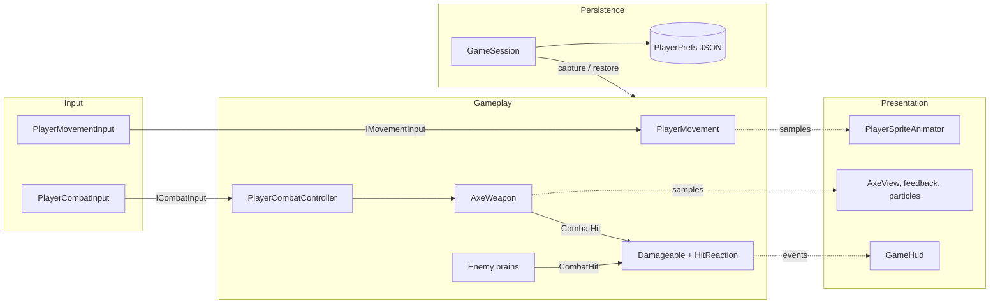
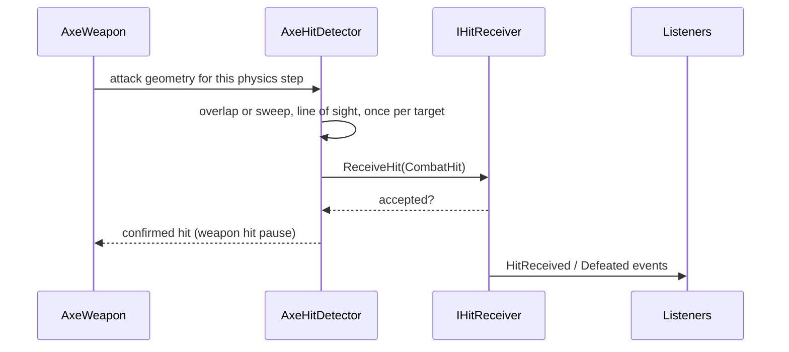
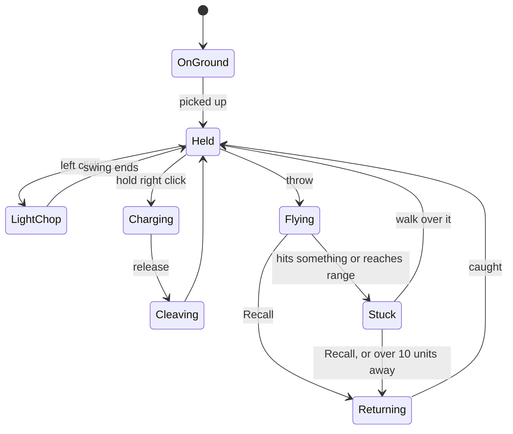
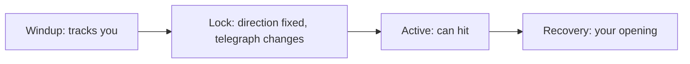
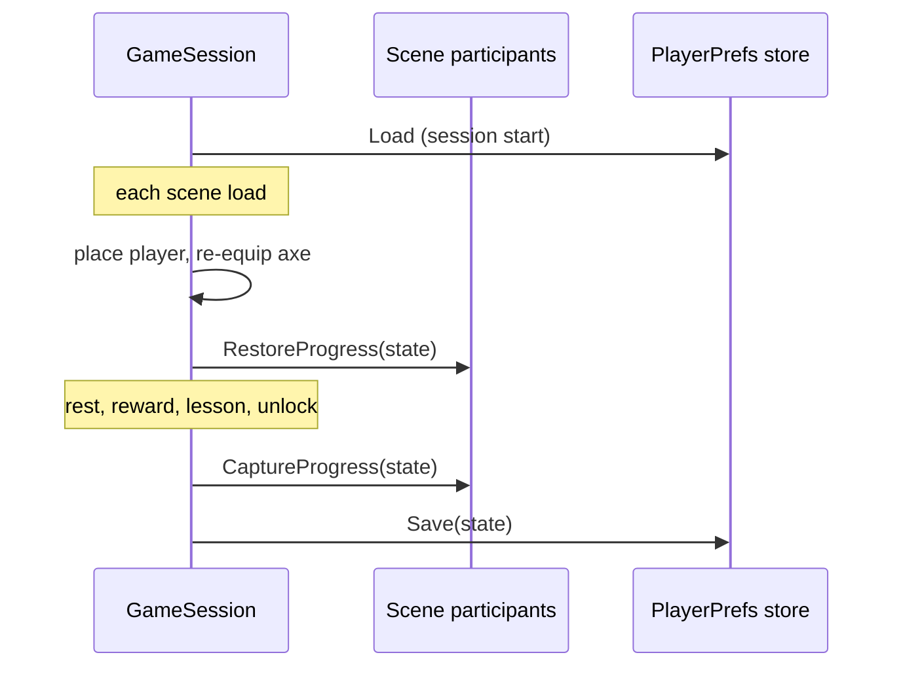

# Systems overview

How the game works under the hood: which component owns what, and how the parts talk.

[Player animation](PlayerAnimation.md) · [World and tilemaps](World.md) · [Changelog](../CHANGELOG.md)

[Architecture](#architecture) · [Player](#player) · [Combat](#combat) · [Enemies](#enemies) · [Saving](#progression-and-saving) · [World](#world-and-interaction) · [Tutorial](#tutorial) · [Camera and UI](#camera-and-ui) · [Tools](#tools) · [Key files](#key-files)

## Architecture

**Gameplay owns state; presentation only samples it.** Each mechanic has one owner component. Everything else reaches it through small interfaces and C# events.

| Rule | In practice |
| --- | --- |
| Single writers | Only `PlayerMovement` sets player velocity, `CameraFollow2D` moves the camera and `PlayerSpriteAnimator` sets the body sprite. Dash, knockback and freelook feed these writers. |
| Input behind interfaces | Gameplay reads `IMovementInput`, `ICombatInput` and `ICameraLookInput`. Bindings live in small adapters. |
| Hits are data | Attacks deliver a `CombatHit` to any `IHitReceiver`. A weapon never knows what it struck. |
| Events for reactions | `Damageable` raises `HitReceived` and `Defeated`. Knockback, particles, health bars, rewards and the HUD subscribe. |
| One action at a time | An enemy brain picks an `IEnemyAction`; `EnemyActionRunner` owns its commitment, contact and cancellation. |
| Leases, not flags | `PlayerControlLocks`, `SimulationPause` and `MenuStack` let overlapping menus and freezes coexist without releasing each other. |
| Tuning in data | Weapons, upgrades, enemy attacks and animations are ScriptableObjects. Scenes hold placement. |

| `Assets/Scripts/` | Holds |
| --- | --- |
| `Input` | Keyboard, mouse and controller adapters; last-used-device tracking |
| `Player` | Motor, stamina, dodge, health, flask, interaction, animation |
| `Weapons` | Axe state machine, hit detection, throw clock, settings, upgrades |
| `Combat` | Hit data, health, reactions, protection |
| `Enemies` | `Brains`, `Abilities`, `Core`, `Presentation` |
| `Progression` | Session, save format and store, rewards, upgrades |
| `World` | Pickups, bonfires, puzzles, passages, water |
| `Tutorial` | Lessons, Recall awakening, guide |
| `UI` | HUD, menus, F3 and F4 panels |
| `Camera`, `Development` | Follow, zoom, freelook; preview and proof drivers |

## Player

`Player.prefab` is shared by every scene. The axe is a separate prefab, equipped on pickup.

### Controls

Prompts follow whichever device was used last.

| Keyboard / mouse | Controller | Action |
| --- | --- | --- |
| WASD / arrows | Left stick | Move |
| Shift (hold) | L3 (click) | Sprint |
| Space | B | Dodge |
| Left click | RB | Light combo: sweep, reverse sweep, thrust |
| Right click (hold, release) | RT (hold, release) | Charged cleave |
| E | LT | Tap to throw, hold to aim; while the axe is away, Recall |
| Mouse | Right stick | Aim |
| Q | X | Drink a flask |
| F | A | Interact |
| Tab | View | Inventory |
| Alt (hold) | LB (hold) + right stick | Look around |
| Wheel | D-pad up/down | Zoom |
| Esc | Start | Pause |
| F3 / F4 | | Debug panel / developer tools |

### Movement

`PlayerMovement` picks what drives the body each physics step, in priority order:

1. **Stagger:** knockback plays out and input is ignored.
2. **Controls lost** (menu, death): the body stops.
3. **Dodge:** 3.2 units over 0.36 s in a locked direction.
4. **Weapon action:** attacks and throws scale walking speed; the finisher adds a lunge.
5. **Free movement:** momentum toward the input velocity (walk 4.5 u/s, sprint 7.2 u/s).

Rope crossings are a separate motor mode between authored anchors.

### Stamina, dodge and flasks

| System | Rule |
| --- | --- |
| Stamina | 100 points. Any action can start above zero and push into a deficit (to −40); attacks made in deficit deal 60% damage and swing 25% slower. Recovers 40/s after 0.6 s. Sprint drains 18/s. |
| Dodge | 18 stamina, no cooldown. The first 0.24 s is invincible. |
| Flask | Three charges, refilled at bonfires. The 0.9 s drink heals 40 late, and a stagger before then wastes it. |
| Damage | 0.8 s of immunity after a hit. Defeat returns to the last bonfire. |

## Combat

Every attack, player or enemy, is a `CombatHit` delivered to an `IHitReceiver`. Only accepted hits raise events, so blocked or duplicate hits produce no feedback.

### The axe

`AxeWeapon` is one state machine for the weapon on the ground, in hand, mid-swing and in flight. The state decides which actions are legal.

| Attack | Shape | Damage | Stamina |
| --- | --- | --- | --- |
| Light 1 / 2 | 160° sweep, then reversed 120° sweep; reach 2.6 | 10 / 10 | 16 / 16 |
| Finisher | Straight thrust at 1.3x reach, with a 0.7-unit lunge | 25 | 24 |
| Charged cleave | 360° spin, radius 2.1; hold as long as you like | up to 30 | 19 to 35, by charge |
| Throw | Flies 7 units at 18 u/s and sticks in what it hits | 15 | 20 |
| Recall | Returns at 16 u/s through terrain, hitting everything on its path except the target it left | 10 | 10 |

Values live in `Assets/Settings/Weapons/AxeSettings.asset`.

- **What you see is what hits.** Damage, the ground footprint and the weapon pose all read one action clock: windup, active, recovery.
- **Hit pause** stops only the weapon's clock (0.045 s, 1.8x on the finisher). Enemies keep moving.
- **Reactions.** `HitReaction` turns accepted hits into stagger and knockback. Enemies can have poise, which breaks only past a threshold; thrown and Recall hits count half.

## Enemies

| Folder | Role |
| --- | --- |
| `Brains` | `PredatorBrain` circles, commits and punishes. `PursuitBrain` approaches, attacks and returns. |
| `Abilities` | `EnemyActionRunner` runs one `IEnemyAction` at a time on a shared phase clock. |
| `Core` | `EnemyBody` owns sight, leash, home and reset. `EnemyRegistry` lets shared systems find enemies. |
| `Presentation` | Sprite views, health bars, awareness marker, weapon view, drawn attack ground. They only sample. |

| Enemy | Brain | Health | Attacks | What it asks of you |
| --- | --- | --- | --- | --- |
| Wolf | Predator | 50 | Lunge, snap | Read the lock, then sidestep or punish the recovery |
| Road Scavenger | Pursuit | 75 | Step-in, overhead | Keep your spacing; watches 0.5 s before it engages |
| Mossback Boar | Pursuit | 90 | Charge, tusk sweep | Bait the charge; hitting a wall head-on stuns it 2.2 s |
| Thorn Rat | Pursuit | 20 | Dart and nip | Don't get surrounded |
| Broken Watcher (boss) | Pursuit, guardian stage | 440 | 360° slam, close sweep, a draw from afar | Leave the ring, fight the pull, punish the recovery |

Every attack follows the same contract, with values in `Assets/Settings/Enemies`:

- **Openings are promises.** At most one follow-up, and recovery is never cancelled.
- **Reading the player.** `PlayerRead` tells both brains what they can see the player doing: drinking, axe away, recovering from a chop. After a 0.15 s beat, scavengers and rats press in and boars start their charge sooner. It never cuts a recovery short.
- **No shared attack turn.** Each enemy attacks on its own rhythm. Groups are shaped by placement and notice radius, so a careful player can pull one at a time.
- **Leash.** An enemy breaks off when it loses sight, or once past its leash with the player out of notice range, then walks home. A hit, or the player coming close, turns it back. All of this lives in `EnemyBody`.
- **Mending.** Out of the fight an enemy heals 10% of its health per second. A boss back on its seat is whole at once.
- **Boss arena.** While its boss is awake, `BossArena` stands fog walls on a rectangle. They hold the boss in, and the player too once fully inside. Only a seated or fallen boss drops them, so any reset reopens the way.

## Progression and saving

`GameSession` is one session for the whole game. It survives scene loads and writes one versioned JSON record to PlayerPrefs. `CheckpointService` owns rest, travel and placement; `RewardService` owns shards, fragments, coins, tools and purchases.

| Event | Checkpoint | Heals, resets enemies | Saves |
| --- | --- | --- | --- |
| Rest at a bonfire | Set to that fire | Yes | Yes |
| Permanent gain (reward, lesson, puzzle) | Unchanged | No | Yes |
| Quit, pause, focus loss | Unchanged | No | Resume point only |
| Leave through a scene exit | Unchanged | No; health and flasks carry over | Yes |
| Death | Unchanged | Through the reload | Yes |
| New Game | Cleared | Through the reload | Save deleted |

- **What's saved:** axe and Recall, checkpoint, discovered fires, shards and upgrades, coins and tools, and a list of permanent string IDs for lessons, rewards and puzzles. Shipped IDs never change.
- **Resume point:** a small record of scene, position, health and flasks, so Continue returns to the exact spot. It is checked against solid collision on load.
- **Old saves:** `ProgressMigrations` upgrades them step by step.
- **Visits:** `SceneVisitState` keeps defeated enemies and cut grass in memory across scene exits, until you rest or die.

**Rewards are three pieces**, so a fight-gated chest is scene setup, not new code: `EncounterUnlock` (the condition), `RewardPickup` (the object in the world) and `RewardService.TryGrant` (the saved record).

**Upgrades** are tiers of three exclusive choices, bought with three Sun Shards at bonfires that offer them. Three heart fragments add 20 maximum health.

## World and interaction

Level construction is in [World and tilemaps](World.md).

| System | Owner | Behaviour |
| --- | --- | --- |
| Interaction (F) | `PlayerBonfireInteraction` | Picks one nearby target. The HUD prompt reads the same selection. |
| Bonfires | `Bonfire` | First use lights it and unlocks travel. Next use rests: heals, refills, resets enemies, sets the respawn point. |
| Place names | `AreaName` | The smallest zone containing the player names the place, shown once per save. |
| Pots and chests | `Breakable`, `CoinSource`, `RewardChest` | Each result saves once, including empty rolls. |
| Hold-up | `RewardHoldUp` | A shard, fragment, tool or chest's contents rises over the hero for about a second while the world stops. The reward is saved first, so it only presents. |
| Material feedback | `SurfaceTag`, `AxeSurfaceFeedback` | A prefab's tag names what it's made of. The axe reports what it strikes, at most one plain object per attack, and the feedback plays that material's sound and flecks. Untagged objects stay silent. |
| Trader | `Trader`, `ShopOffer`, `CollectionMenu` | Talk, then trade. A purchase saves coins, item and stock together. |
| Rope | `RopeAnchor`, `RopeRoute` | A bought kit secures a saved two-way route. |
| Inscriptions | `ForgeInscription`, `InscriptionReader` | Reading saves the knowledge; the carving stays. |
| End card | `EndCard`, `InscriptionReader` | A rereadable card where a build stops, offered after a milestone. |
| Recall puzzles | `RecallAwakeningStone`, `RecallSluice`, `RecallRelease` | Bind a lodged axe and its return hits to one flight. |
| Gates and bridges | `PermanentPassage` | One-time. Collision holds until the animation ends and restores on load. |
| Roofs | `BuildingCutaway` | Roofs fade while the player's feet are inside authored rectangles. |
| Dark interiors | `DarkInterior` | Global light is zero. The lantern is a 2D light with wall shadows; a cover shader blacks out unlit pixels. |

## Tutorial

One verb per space. Each lesson completes from a real outcome, not a key press.

| Beat | Teaches | Completed by |
| --- | --- | --- |
| Village well | Movement | Distance walked |
| Axe stump | Pickup | Owning the axe |
| Shrubs, throw stands | Swing, throw, retrieve | Clearing a shrub; a thrown hit, then the axe back in hand |
| Practice dummy, cracked stone | Combo, dodge, cleave | Three melee hits; a dodge; a full-charge break |
| Forest road | Sprint | Distance sprinted |
| Ruins | First fight, healing | A lone wolf; a flask heal |
| Ancient stone | Recall | A thrown hit once the wolf is dead and you've recovered |
| Meadow | Wolf pack, first Sun Shard | Both wolves; collecting the shard |
| Roadside bonfire | Rest | First rest |

`TutorialGuide` holds an ordered list of steps edited in the Inspector. It shows the first incomplete step past the furthest landmark reached, so skipped lessons stop following the player. Lessons only record milestones, so a new lesson needs no guide code.

## Camera and UI

**Camera** (`FollowCamera.prefab`): `CameraFollow2D` is the only writer of position, `CameraZoom2D` keeps the player's zoom for the session and `CameraFreelook2D` looks up to five tiles away and holds there until the player moves, then eases back. The bonfire and dialogue close-ups request framing and zoom through owner-released overrides.

**HUD** (`GameHud`, UI Toolkit) is contextual, so quiet exploration shows almost nothing.

| Piece | Shows |
| --- | --- |
| Vitals | Health and flasks on damage, healing or combat; a setting keeps them on |
| Stamina arc | Pixel arc over the hero whenever stamina is below full |
| Prompt | One `[F] verb` chip above the selected target |
| Boss bar | Name and long health bar along the bottom during a boss fight |
| Hints and receipts | One guide hint; up to three reward notices |
| Inventory | Tab: resource counts, tools and discovered knowledge |

- **UI kit:** every panel, menu and chip shares `UI/Kit.uss` and the RotOK pixel fonts, at 2 reference pixels per UI pixel on a 960x540 canvas.
- **World meters:** enemy bars and the charge bar are small world-space documents, so they scale with what they measure.
- **Menus:** `MenuStack` routes input to the top menu. Title, pause, bonfire and defeat screens share one theme. Pause lists every control for both devices from `ControlLabels`, the source the prompts use.
- **Atmosphere:** `RegionAtmosphere` lays a grade, cloud shadows and motes over each region, with Restrained (default) and Cinematic looks.
- **Feedback:** `PlayerHitFeedback` flashes, kicks the camera and blinks the hero; `FeedbackSettings` scales it down for players who prefer less.

## Tools

- **Combat Effects Preview** (Unity menu): replays attacks against a target with slow motion and frame stepping.
- **F3 Debug Panel:** read-only performance, player, world and save readouts.
- **F4 Developer Tools:** restore, grants, god mode, no collision, show collision, game speed, reset enemies and fallen bosses, and travel to any fire or arrival point.
- [Tools](../Tools/README.md): art exporters, pacing simulator, release packaging and regression checks.

Limits today: Barrow Woods and later regions are unbuilt, Settings is small, and some body attack animations are still pending.

## Key files

| Responsibility | Source |
| --- | --- |
| Player velocity | [PlayerMovement](../RoadOfTheOldKing/Assets/Scripts/Player/PlayerMovement.cs) |
| Weapon state and attacks | [AxeWeapon](../RoadOfTheOldKing/Assets/Scripts/Weapons/AxeWeapon.cs) |
| Hit geometry | [AxeHitDetector](../RoadOfTheOldKing/Assets/Scripts/Weapons/AxeHitDetector.cs) |
| Hit data | [CombatHit](../RoadOfTheOldKing/Assets/Scripts/Combat/CombatHit.cs) |
| Enemy brains | [PredatorBrain](../RoadOfTheOldKing/Assets/Scripts/Enemies/Brains/PredatorBrain.cs), [PursuitBrain](../RoadOfTheOldKing/Assets/Scripts/Enemies/Brains/PursuitBrain.cs) |
| Enemy actions | [EnemyActionRunner](../RoadOfTheOldKing/Assets/Scripts/Enemies/Abilities/EnemyActionRunner.cs) |
| Session and saving | [GameSession](../RoadOfTheOldKing/Assets/Scripts/Progression/GameSession.cs), [ProgressState](../RoadOfTheOldKing/Assets/Scripts/Progression/ProgressState.cs) |
| Rest, travel, respawn | [CheckpointService](../RoadOfTheOldKing/Assets/Scripts/Progression/CheckpointService.cs) |
| Rewards and purchases | [RewardService](../RoadOfTheOldKing/Assets/Scripts/Progression/RewardService.cs) |
| Contextual HUD | [GameHud](../RoadOfTheOldKing/Assets/Scripts/UI/GameHud.cs) |
| Hero sprites | [PlayerSpriteAnimator](../RoadOfTheOldKing/Assets/Scripts/Player/PlayerSpriteAnimator.cs) |
