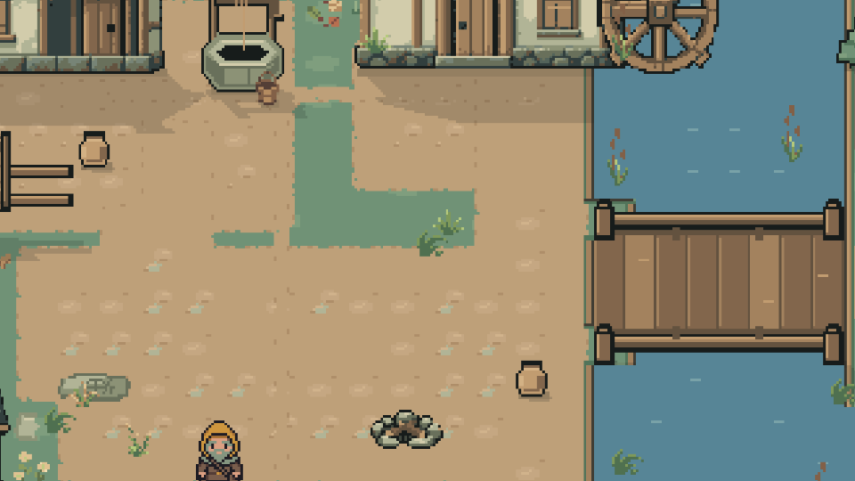
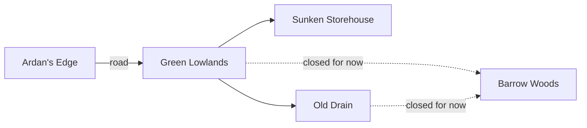
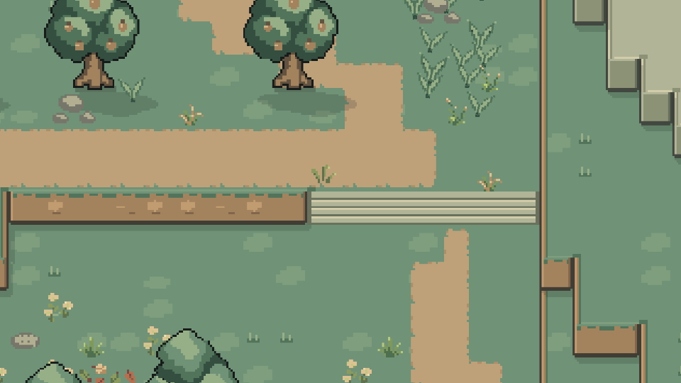
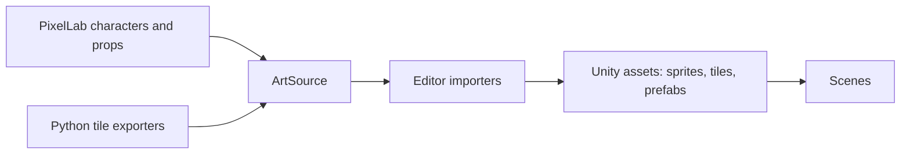

# World and tilemaps

How levels are built and drawn.

[Systems overview](SystemsOverview.md) · [Player animation](PlayerAnimation.md)

[Regions](#regions) · [Layers](#tilemap-layers) · [Elevation](#elevation) · [Terrain](#terrain-tiles) · [Water](#water) · [Vegetation](#interactive-vegetation) · [Light and shadow](#light-and-shadow) · [Art pipeline](#art-pipeline)



## Regions



| Scene | What it is |
| --- | --- |
| `Title` | Title screen and prologue |
| `Tutorial` | Ardan's Edge: village, practice terrace, forest, river, ruins |
| `GreenLowlands` | Farm country, orchard, waterworks and basin, roughly 160×105 units plus the arrival road |
| `LowlandsStorehouse`, `OldDrain` | Dark interiors that need the lantern |
| `BarrowApproach` | Retained connector, closed until Barrow Woods is rebuilt |

Scenes load one at a time through `SceneExit` and named `SceneSpawnPoint` arrivals, behind a fade.

## Tilemap layers

Art and collision are independent: a water or cliff tile isn't an obstacle until the Collision map says so.

| Layer | Holds |
| --- | --- |
| Ground | Grass, earth, stone |
| Terrain | Banks, water, cliffs, stairs |
| Paths | Dirt lanes, paving |
| Environment | Trees, buildings, rocks, ruins |
| Detail / Decoration | Ground accents, small props |
| Collision | Invisible boundaries and footprints |
| Above Player | Canopies, roofs |
| Gameplay / Encounters | GameObjects: pickups, puzzles, bonfires, enemies |

Every scene shares one hierarchy. The region root (a Grid) holds `Collision`, the ground and path maps, `Terrain`, `Scenery`, `Gameplay`, `Encounters` and editor-only `Authoring` guides. `Player`, `Game Session`, `Cameras` and `Lighting` sit at the scene root.

Trees and buildings are prefabs with separate base, overhead and collision parts, so the hero can walk behind a canopy but not through a trunk.

## Elevation

Height is drawn, not simulated. Everything shares one 2D physics plane, with no jumping and no height switching.



```
 Ridge +1   ░░░░░░░░░░░░   top surface
            ▓▓▓▓▓▓▓▓▓▓▓▓   one 16 px front row per level
 Farm   0   ░░░░░░░░░░░░
            ▓▓▓▓▓▓▓▓▓▓▓▓
 Basin -1   ░░░░░░░░░░░░   under water until the sluice drains it
```

- One level is one 16 px row of front wall. Side edges are 4 px and rear rims 2 px, each with matching collision.
- Stairs and ramps are the only walking links between heights.
- The **Height Brush** paints an editor-only plan over the scene. It records intent and never changes art or collision by itself.

## Terrain tiles

Art is native 16×16 at 16 pixels per unit, point filtered. RuleTiles pick the right edge, corner or junction from their neighbours; five materials cover all 47 combinations. Separate maps let paths overlap ground without replacing it. The shared ground, terrain, path and tree kits live in `Assets/Art/Tiles/Shared`, and regions own only their variants and buildings.

## Water

- **Animated tiles:** ripples, falls and foam each loop four frames with no custom script.
- **Draining:** `SluiceWaterReveal` retreats the water by a baked bed-depth map, so shallow edges appear first. It's a shader over the existing art rather than a fluid simulation. Collision swaps when the reveal ends, and rest or load settles straight to the saved state.

## Interactive vegetation

Grass, flowers and reeds sway, bend away from the player and get cut by real weapon sweeps.

- `InteractiveVegetation` draws baked `VegetationLayout` data in small mesh chunks: no object or collider per plant.
- Leaves rotate on the GPU around their roots. This deliberately smooth motion is an exception to the pixel grid.
- Depth follows each plant's root against the player's feet, using an extra draw only in nearby chunks.
- Cut plants stay cleared through scene visits and regrow on rest. Debris uses a fixed particle pool.

## Light and shadow

- **Outdoor grade:** a shared URP Volume sets contrast and warmth without blurring pixel edges.
- **Baked shadows:** buildings, trees and props cast short shadows into native 16 PPU masks. Terrain casts only from real faces onto lower ground. Run **Scene Tools > Update shadows** after moving scenery.
- **Local light:** bonfires are real 2D lights. Interiors have no global light, so the lantern does the work.
- **Atmosphere:** each region lays cloud shadows, mist and motes over the world.

## Art pipeline



Generators and importers run only in the Editor, so the game just consumes ordinary Unity assets. See [ArtSource](../ArtSource/README.md) for sources and [Tools](../Tools/README.md) for exporters. Palettes are in [Art/Palettes](Art/Palettes).
